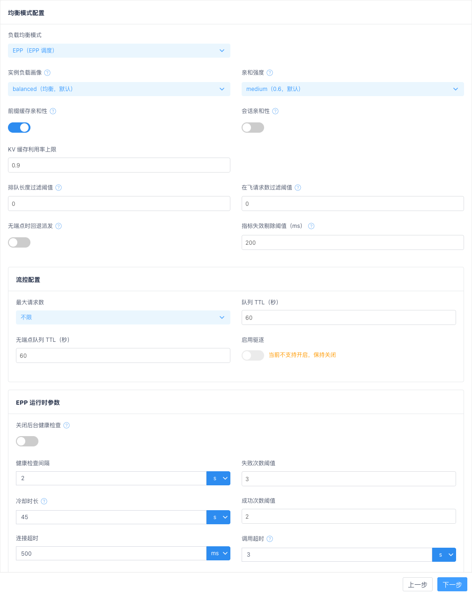
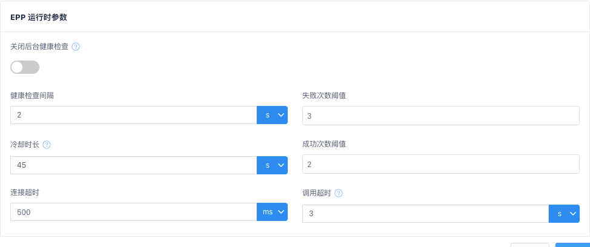

# 03 资源管理：AI 业务集群

业务集群是**流量转发与治理策略**在网关内的抽象：在已创建的模型服务商之上，配置协议、会话保持、超时重试、被动健康检查，并选择转发模型与 Key 权重。路由规则的目标即为「集群 + 模型」，请求经集群转发到**所属服务商**的实例池。

> **前置条件**：须先在 [05 章 模型服务商](05-model-provider.md) 中创建好服务商（实例池、协议、模型、Keys），再在集群向导中选择「所属服务商」。

## 首次接入最小配置

| 向导步骤 | 必填项 |
| ------ | ------ |
| 1 基础配置 | 集群名称、协议（http / https，与后端实际一致） |
| 4 大模型配置 | 所属服务商、转发模型（至少 1 个）；多 Key 时配置权重 |
| 2 / 3 / 5 | 保持默认，直接下一步 |

## 3.1 集群列表

进入 资源管理 → AI业务集群，展示当前已创建的集群列表。

**表格列说明**：

| 列名 | 说明 |
| --- | --- |
| 名称 | 集群名称，支持按名称搜索和排序 |
| 描述 | 集群说明 |
| 操作 | 详情、编辑、删除 |

列表上方有「添加集群」按钮。

### 查看详情

点击「详情」，右侧弹出抽屉，以只读方式展示全部配置（基础配置、超时和重传、被动健康检查、大模型配置），与 [3.7 步骤 5：复查&检查](#37-步骤-5复查检查) 汇总面板一致。**不展示**服务商实例池（实例池归属服务商资源）。

### 删除集群

点击「删除」，弹出确认框。确认后删除成功并刷新列表。

**被路由规则引用时**：弹出失败提示，说明被哪张路由表、哪条规则引用，并提供「前往处理」链接。需先在路由表中解除引用。

## 3.2 创建 / 编辑集群

点击「添加集群」，右侧弹出 **5 步向导**：

1. 基础配置 → 2. 超时和重传 → 3. 被动健康检查 → 4. 大模型配置 → 5. 复查&检查

> **与 0.0.7 及更早版本的区别**：向导已移除「实例配置」步骤；实例池改在模型服务商模块维护。

编辑已有集群时，同样抽屉以编辑模式打开，字段预填充。集群名称创建后不可修改。

## 3.3 步骤 1：基础配置

| 字段 | 必填 | 默认值 | 校验规则 | 说明 |
| --- | --- | --- | --- | --- |
| 集群名称 | 是 | 空 | 1-64 字符；仅允许字母、数字、点、下划线、中划线；不能以点、下划线、中划线开头或结尾；不能与已有集群重名 | 唯一标识，创建后不可修改 |
| 集群说明 | 否 | 空 | 不超过 256 字节（按 UTF-8 字节计，一个汉字占 3 字节）；不能包含控制字符 | 描述用途 |
| 协议 | 是 | `https` | — | http / https，按后端实际选择 |
| 单个后端最大空闲连接数 | 否 | `0` | 非负整数；不超过 99999999 | 每个后端实例维持的空闲长连接数；0 表示不特别维持 |
| 会话保持 | 否 | 停用 | — | 启用 / 停用 |
| 哈希策略 | 条件必填 | `CLIENT_IP_ONLY` | — | 会话保持启用时显示 |
| 哈希头部 | 条件必填 | 空 | 策略为 CLIENT_ID_ONLY / CLIENT_ID_PREFERED 时必填 | Header 名称或 `Cookie:{key}` |
| 请求写缓存大小（Byte） | 否 | `512` | 正整数 | 向后端写请求时的缓存大小 |
| 后端连接随客户端连接关闭 | 否 | 停用 | — | 启用后客户端断开时同步关闭后端连接 |

**哈希策略**（会话保持启用后可选）：

| 策略 | 含义 | 哈希头部 |
| --- | --- | --- |
| CLIENT_IP_ONLY | 仅根据客户端 IP 做会话保持 | 不需要 |
| CLIENT_ID_ONLY | 仅根据哈希头部做会话保持 | 必填 |
| CLIENT_ID_PREFERED | 优先哈希头部，无头部时回退到客户端 IP | 必填 |

## 3.4 步骤 2：超时和重传

| 字段 | 默认值(ms) | 说明 |
| --- | --- | --- |
| 客户端连接空闲超时 | `30000` | 长连接空闲回收 |
| 读客户端请求Body超时 | `30000` | 读 body + 等待后端 + 写响应的总超时 |
| 连接后端超时 | `50000` | 建连超时 |
| 读后端响应头部超时 | `50000` | 首包超时，流式场景关键 |
| 写响应超时 | `60000` | 向客户端写完全部响应的超时 |
| 集群内重试次数 | `2` | 同集群内转发失败重试次数 |

> 大模型推理首包耗时较长，「读后端响应头部超时」建议按服务商 SLA 放宽。

## 3.5 步骤 3：被动健康检查

| 字段 | 必填 | 默认值 | 说明 |
| --- | --- | --- | --- |
| 故障阈值 | 否 | `3` | 连续转发失败超过该值后实例置为不健康并启动探测 |
| 健康检查间隔(ms) | 否 | `1000` | 探测间隔 |
| 健康检查Host | 否 | 空 | 留空时使用**所属服务商首个实例**地址 |
| 健康检查Uri | 否 | `/` | 必须以 `/` 开头 |
| 健康检查期望的状态码 | 否 | `0` | 0 表示忽略状态码，有响应即健康 |

## 3.6 步骤 4：大模型配置

选择所属服务商后，系统加载该服务商的模型列表与 Key 名称，集群侧只配置**选用哪些模型、各 Key 权重及转发策略**。

### 模型服务配置

| 字段 | 必填 | 说明 |
| --- | --- | --- |
| 所属服务商 | 是 | 下拉选择已创建的服务商；集群引用其实例池、协议与 Keys |
| 转发模型 | 是 | 多选，仅能选所属服务商已配置的模型；下拉首项提供「全选」 |
| 裁剪前缀 | 否 | 开关；用于 OpenRouter 等聚合场景 |
| 匹配前缀 | 条件必填 | 开启裁剪前缀时必填，须以 `/` 结尾，如 `openrouter/` |

### 模型重定向

将客户端请求的模型名映射为转发到后端的模型名。选择「转发的后端模型名称」后，若「原请求的模型名称」为空，会自动填入同名，之后仍可修改。原模型名不能重复；目标模型须从「转发模型」已选项中选择。

> 与 API-Key 允许/禁止模型的组合：Key 的模型访问控制按**重定向后**的目标模型判定。例如原模型名 `glm-5.2-abc`、目标模型 `glm-5.2` 时，Key 允许模型配置 `glm-5.2` 即可放行客户端发送的 `model=glm-5.2-abc` 请求（详见 [12.7 运行时生效机制](12-api-key.md#127-运行时生效机制)）。

### 服务鉴权 Keys

| 字段 | 必填 | 说明 |
| --- | --- | --- |
| Key | 否 | 从所属服务商已配置的 Key **名称**中选择（**不填写 Key 明文**） |
| 权重 | 条件必填 | 0-100；有配置 Key 时所有行权重之和须等于 100 |

- 非必填：不配置时由网关按服务商 Keys 默认策略处理。
- 空行不参与校验；有值的 Key 名称须属于所选服务商。
- 同一 Key 不可选两次：已选名称会从其他行的下拉中过滤掉。

### Key 路由策略

| 字段 | 默认值 | 说明 |
| --- | --- | --- |
| 策略 | `weighted_random` | 本版仅支持加权随机 |
| 最大重试次数 | `0` | 请求失败后的 Key 级重试 |
| 退避初始值(ms) | `500` | 重试退避初始等待 |
| 退避最大值(ms) | `5000` | 须 ≥ 退避初始值 |

### Key 亲和性

| 字段 | 默认值 | 说明 |
| --- | --- | --- |
| 是否启用 | 启用 | 开启后同一会话请求绑定同一 Key，避免会话内 Key 漂移 |
| 空闲超时(秒) | — | 启用时必填，须为大于 0 的整数 |
| Key 惩罚 | 停用 | 开启后失败 Key 被临时降权 |
| Redis Key 前缀 | `bfe:ai:key_affinity` | 启用时必填；依赖数据面 Redis 配置 |

> Key 亲和性需数据面配置可用 Redis；Redis 不可用时自动降级为加权随机。

### 均衡模式配置

位于「Key 亲和性」卡片之后，用于选择集群的**后端负载均衡模式**。

| 字段 | 必填 | 默认值 | 校验规则 | 说明 |
| --- | --- | --- | --- | --- |
| 负载均衡模式 | 否 | `WRR（加权轮询）` | 枚举：`WRR` / `EPP` | `WRR`：BFE 本地加权轮询；`EPP`：由 EPP 调度器接管后端选择（实例分配见 [06 章 EPP 调度](06-epp-schedule.md)） |

- 选 `EPP` 时 `epp_config` **必填**：只把模式切到 `EPP`、不带均衡配置提交会被拒绝（`422`）。
- 选 `WRR` 时 `epp_config` 可选；传入的配置仅保留（休眠），不编译、不下发。

选择 `EPP` 时展示以下配置项（`epp_config`）：

| 字段 | 必填 | 默认值 | 校验规则 | 说明 |
| --- | --- | --- | --- | --- |
| 实例负载画像 | 否 | `balanced（均衡）` | 枚举：`queue-first` / `balanced` / `kv-first` | 多个后端都可用时的偏向：`queue-first` 排队优先（通常更低延迟）/ `balanced` 均衡 / `kv-first` KV 空闲优先（通常更高吞吐）；只调节「排队」与「KV」两个基础 scorer 的权重 |
| 亲和强度 | 否 | `medium（0.6）` | 枚举：`off` / `low` / `medium` / `high` | 把「相同前缀 / 同一会话」的请求往同一后端聚的力度：`off` 不注入亲和 scorer（前缀缓存亲和、会话亲和即使开着也不注入）/ `low` 权重 `0.3` / `medium` `0.6` / `high` `1.0` |
| 前缀缓存亲和性 | 否 | 启用 | 布尔 | 相同 prompt 前缀的请求经前缀哈希匹配**尽力收敛**到同一后端，提升 KV cache 复用；软亲和，不保证命中 |
| 会话亲和性 | 否 | 停用 | 布尔 | 同一会话的请求**尽力粘住**同一后端；绑定端点摘除后自动迁移重粘 |
| 会话亲和性 Header | 条件必填 | 空 | 非空 Header 名 | 启用会话亲和性时必填，如 `x-session-id`；关闭时保留但不生效 |
| KV 缓存利用率上限 | 否 | `0.9` | 大于 0 且 ≤ 1 | KV cache 利用率超过该值的端点被过滤；该值是 **KV 阈值单一来源** |
| 排队长度过滤阈值 | 否 | `0` | ≥ 0 的数 | 后端排队长度超过该值的端点被过滤；`0` = **不启用**该项过滤（不是「上限为 0」），大于 0 时该值是队列阈值单一来源 |
| 在飞请求数过滤阈值 | 否 | `0` | ≥ 0 的数 | 后端运行中请求数超过该值的端点被过滤；`0` = 不启用该项过滤 |
| 无端点时回退派发 | 否 | 关闭 | 布尔 | 所有端点都被过滤时的行为：关闭 = 无端点可选、不派发；开启 = 回退派给「最不差」的端点 |
| 指标失效剔除阈值（ms） | 否 | `200` | 大于 0 的整数 | 后端指标超过该时长未更新即从调度候选剔除，直到恢复抓取；EPP 约每 50ms 抓取一次后端 `/metrics`，`200` 约等于连续 4 次抓取失败，建议 100–500 |
| 流控配置 | 否 | 见下表 | — | 普通卡片（无折叠交互），见下表 |

**流控配置**（`flow_control`）：

| 字段 | 必填 | 默认值 | 校验规则 | 说明 |
| --- | --- | --- | --- | --- |
| 最大请求数 | 否 | `不限` | `不限` / `限制`（大于 0 的整数） | 全局并发上限；选「限制」后须填写大于 0 的整数，选「不限」按 `-1` 提交 |
| 队列 TTL（秒） | 否 | `60` | ≥ 0 的整数 | 池有端点时的排队预算，超期以可重试背压错误拒绝；`0` 为显式禁用驱逐 |
| 无端点队列 TTL（秒） | 否 | 跟随队列 TTL | ≥ 0 的整数 | 池无端点（冷启动扩容）时的排队预算 |
| 启用驱逐 | 否 | 关闭 | 仅允许 `false`，提交 `true` 被拒绝 | 高优先级请求被饱和阻塞时终止低优先级在飞请求、回收容量。**当前 EPP 未接线**，界面为禁用态只读开关，并提示「当前不支持开启，保持关闭」 |

### EPP 运行时参数

选择 `EPP` 时，除 `epp_config` 外，还可配置 BFE 访问 EPP 调度器时的**健康检查与调用超时**参数（`epp_runtime`）；不配置时由 BFE 补默认值。

**健康检查**（`check`）：

| 字段 | 必填 | 默认值 | 校验规则 | 说明 |
| --- | --- | --- | --- | --- |
| 关闭后台健康检查 | 否 | 停用 | 布尔 | 启用后 BFE 不再对 EPP 端点做主动健康检查；不建议生产关闭 |
| 健康检查间隔 | 否 | `2s` | 合法且大于 0 的时长 | 两次探测的间隔 |
| 失败次数阈值 | 否 | `3` | 整数且 ≥ 1 | 连续失败达到该值判定端点不健康 |
| 冷却时长 | 否 | `45s` | 合法且大于 0 的时长 | 端点被判定不健康后的冷却时间 |
| 成功次数阈值 | 否 | `2` | 整数且 ≥ 1 | 连续探测成功达到该值恢复为健康 |

**调用超时**（`timeout`）：

| 字段 | 必填 | 默认值 | 校验规则 | 说明 |
| --- | --- | --- | --- | --- |
| 连接超时 | 否 | `500ms` | 合法且大于 0 的时长 | 与 EPP 建连超时 |
| 调用超时 | 否 | `3s` | 合法且大于 0 的时长 | 单次调用 EPP 的超时 |

**时长字段的输入控件**：

- 健康检查间隔、冷却时长、连接超时、调用超时这 4 个字段是「数字框 + 单位下拉（`ms` / `s` / `m`）」复合控件；健康检查间隔、冷却时长、调用超时默认单位为 `s`，连接超时默认单位为 `ms`。
- 切换单位时会换算数值、保持物理时长不变（`500ms` 切到 `s` 显示 `0.5s`）。
- 存量值若为无法拆分的组合写法（如 `1m30s`），该字段回退为纯文本输入框并原样展示，不做换算。
- 校验：须为大于 0 的合法 Go duration（`+1s`、`1.s`、`.5s` 等写法合法）；填 `0` 会在提交时被拦截报错，**不会静默回落为默认值**；清空数字框表示未设置，提交时按默认值补齐。

> - `tls` 与 `breaker` **不对外暴露**：由后端固定下发（`EPPTLS` 为明文、`EPPBreaker` 关闭），界面不提供配置入口。
> - 未配置时展示为「未配置（BFE 补默认）」，由 BFE 按上表默认值运行，与「已落盘一组默认值」不同。
> - 7 个字段中只有 3 个带 `?` 提示图标：关闭后台健康检查、冷却时长、调用超时；其余字段无提示。

> **WRR ↔ EPP 切换**：`epp_config` 与 `epp_runtime` 仅在 `EPP` 模式下生效；切回 `WRR` 时配置**保留但不生效**（休眠），再切回 `EPP` 继续生效，来回切换不丢配置。

## 3.7 步骤 5：复查&检查

汇总展示前 4 步配置，确认后点「提交」。

| 面板 | 展示内容 |
| --- | --- |
| 基础配置 | 名称、说明、协议、连接与会话保持相关项 |
| 超时和重传 | 各项超时与集群内重试 |
| 被动健康检查 | 阈值、间隔、Host（空时展示「为空时使用所属服务商首个实例地址」）、Uri、状态码 |
| 大模型配置 | 所属服务商、转发模型、裁剪前缀、模型重定向、Keys 权重、Key 路由策略、Key 亲和性、均衡模式配置（EPP 模式含 [EPP 运行时参数](#epp-运行时参数)，未配置时显示「未配置（BFE 补默认）」） |

## 3.8 注意事项

- 集群名称创建后不可修改。
- 修改集群会影响所有引用该集群的路由规则，建议低峰期操作。
- 健康检查 Host 留空时，使用所属服务商实例池首个实例地址。
- 转发模型必须是所属服务商模型列表的子集；更换服务商后须重新选择模型与 Keys。
- 删除集群前须解除路由规则引用。
- EPP 模式集群的后端选择由 EPP 调度器接管；若实例池中无有效分配（未分配态），该集群导出配置时会**降级为 WRR**。分配关系在「EPP调度」页查看与覆写，见 [06 章](06-epp-schedule.md)。
