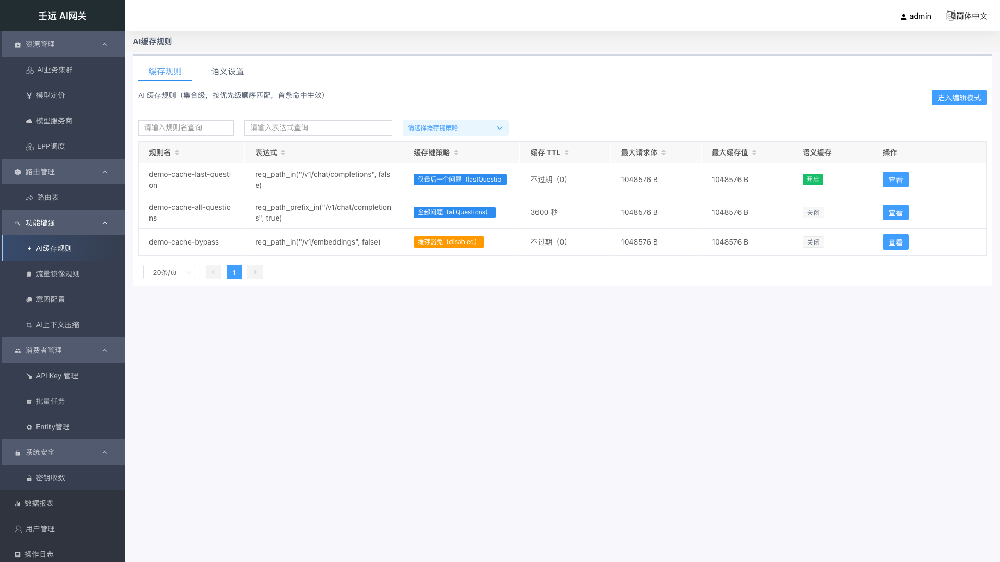
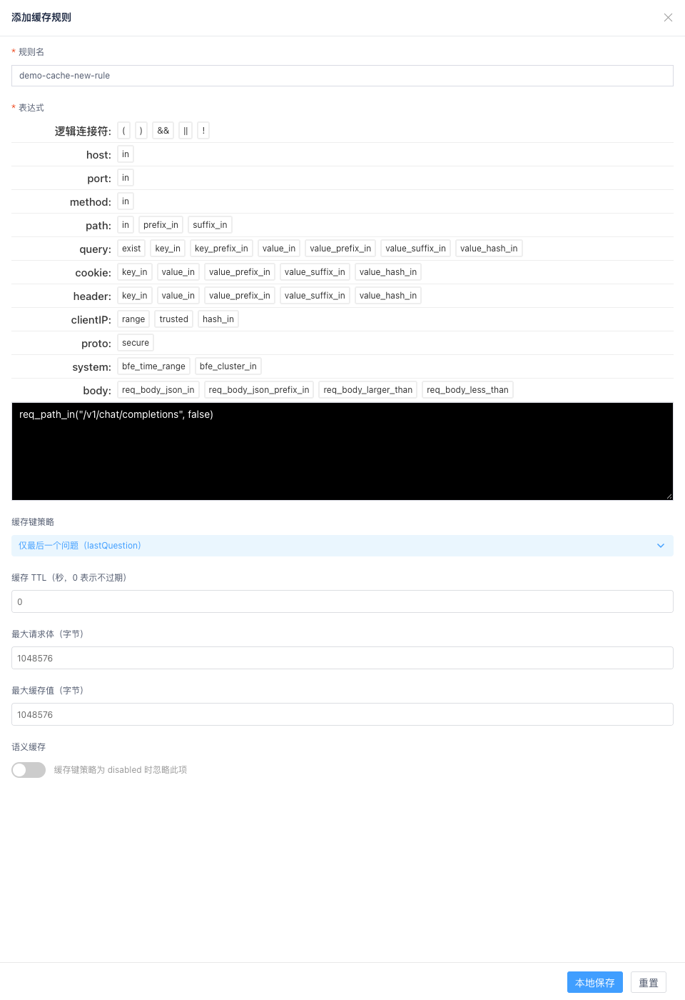
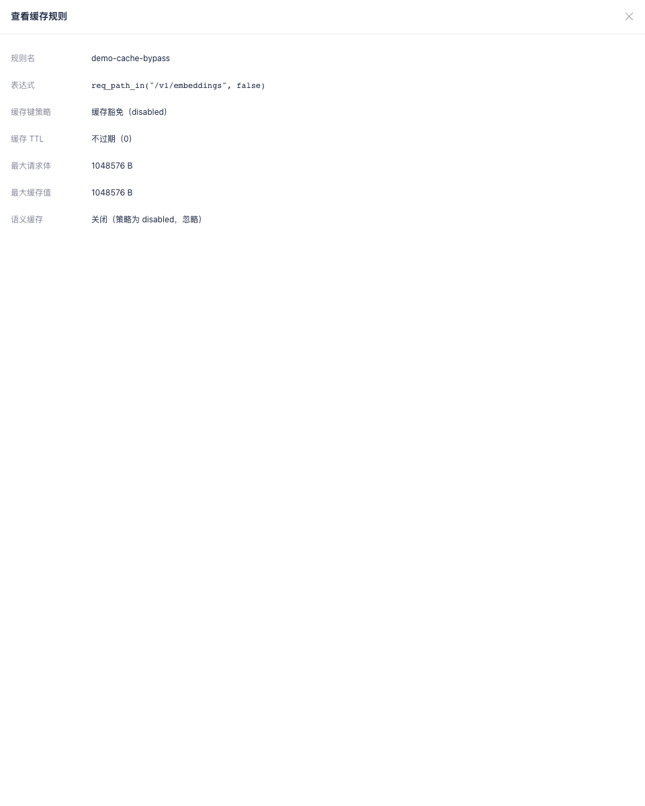

# 08 功能增强：AI缓存规则

AI 缓存规则用来回答两个问题：**哪些请求允许走应答缓存**、**用什么规则去算缓存键**。命中缓存时网关直接返回上一次相同请求的应答，不再转发到后端模型服务，从而降低推理成本、压缩首字延迟。

菜单路径：**功能增强 → AI缓存规则**（页面路由名 `AICacheRule.list`）。页面由两个页签组成，各管一块配置：

| 页签 | 内容 | 如何生效 |
| --- | --- | --- |
| 缓存规则 | 规则列表（集合级，8 列）；支持「视图 / 编辑」双模式；页头右上角为「进入编辑模式」，或编辑态下的「退出编辑模式」+「提交并生效」 | 点「提交并生效」一次性整体下发全部规则 |
| 语义设置 | 语义缓存全局设置（单例，全局生效）；查看态为纯文案，编辑态为三字段表单；页头右上角为「编辑」，或编辑态下的「取消」+「保存」 | 点「保存」单独下发，与规则集合互不影响 |

两件事必须先记住：

- **规则按列表顺序匹配，首条命中即生效**，所以列表顺序本身就是优先级，界面不提供显式的「优先级」字段。
- 规则集合是**整体替换**的（没有单条启用开关，「不要这条规则」就是从列表里删掉它）；语义设置是**单例覆盖**的，清空规则不会影响语义设置，反之亦然。

## 8.1 页面构成与规则列表

进入页面后默认停在「缓存规则」页签，页头左侧是页面标题「AI 缓存规则（集合级，按优先级顺序匹配，首条命中生效）」。

**表格列说明**：

| 列名 | 说明 |
| --- | --- |
| 规则名 | 规则标识，用于可读性与审计（不是寻址键）；支持搜索 |
| 表达式 | 生效条件，命中该表达式的请求启用缓存；支持搜索 |
| 缓存键策略 | 标签展示：仅最后一个问题（`lastQuestion`）／全部问题（`allQuestions`）／缓存豁免（`disabled`）；`disabled` 为橙色标签，其余为蓝色标签；支持下拉筛选 |
| 缓存 TTL | `0` 显示「不过期（0）」，其他值显示「`{值}` 秒」；空值显示 `-` |
| 最大请求体 | 按 `{值} B` 展示（如 `1048576 B`）；空值显示 `-` |
| 最大缓存值 | 按 `{值} B` 展示；空值显示 `-` |
| 语义缓存 | 标签「开启」（绿色）／「关闭」（灰色） |
| 操作 | 视图模式仅「查看」；编辑模式为「编辑」「删除」 |

**行顺序**：表格行顺序与接口返回的规则数组顺序完全一致（首行 = 数组第 1 项 = 最高优先级），列表不做任何自动重排；**编辑模式下可直接拖拽行调整生效次序**（列表下方有「拖动表格可修改生效次序」提示），表头排序仅为展示、不影响实际顺序。

**搜索、排序与分页**：

- 表头下方有一行搜索框，可对「规则名」「表达式」做关键字模糊查询，「缓存键策略」为下拉筛选（提示「请选择缓存键策略」）；搜索在前端对已加载的规则集合即时过滤，接口本身不接收分页与筛选参数。
- 点击「规则名」「表达式」「缓存键策略」「缓存 TTL」「最大请求体」「最大缓存值」的表头可排序，点击顺序为升序 → 降序 → 取消排序。「语义缓存」「操作」两列不支持排序。
- 底部分页默认每页 20 条，可切换每页 20 / 30 / 40 / 50 条。
- 加载失败时页面提示「加载 AI 缓存规则失败」，表格为空。

## 8.2 视图 / 编辑双模式与「提交并生效」

规则的增、删、改必须在**编辑模式**下进行。同一个规则列表在两种模式下呈现不同的按钮：

| 页面状态 | 页头左侧 | 页头右上角 | 行「操作」列 |
| --- | --- | --- | --- |
| 视图模式（默认） | — | 「进入编辑模式」 | 「查看」 |
| 编辑模式 | 「添加规则」 | 「退出编辑模式」「提交并生效」 | 「编辑」「删除」 |

**标准操作顺序（两步保存，缺一不可）**：

| 步骤 | 操作 | 作用 | 是否影响线上 |
| --- | --- | --- | --- |
| 1 | 点击「进入编辑模式」 | 进入可编辑状态 | 不影响 |
| 2 | 添加 / 编辑 / 删除规则 | 修改规则内容 | 不影响 |
| 3 | 点击抽屉里的「本地保存」 | 把这条规则放进页面列表（本地草稿） | **仍不影响** |
| 4 | 点击「提交并生效」 | 把整个规则集合真正下发到网关 | **正式生效** |

> 关键提醒：只有第 4 步「提交并生效」才会让规则生效。只点了「本地保存」就退出页面，改动会丢失。

**退出编辑模式**：若本次编辑产生了未提交的改动，点击「退出编辑模式」会弹出「信息提示」对话框，内容为「当前有未提交的改动，退出编辑模式将丢弃这些改动，确认退出？」。点「确定」回滚到进入编辑模式前的规则快照并提示「已退出编辑模式」；点「取消」留在编辑模式并提示「已取消退出」。没有改动时直接退出，不弹窗。

**提交并生效**：按钮带加载态，提交前先做集合内**规则名与表达式（生效条件）双重查重**，重名提示「规则名称已存在，集合内必须唯一」、表达式重复提示「生效条件已存在，集合内必须唯一」，命中即中断且不下发请求。提交以「整体替换」语义写入整个规则集合：不在提交列表中的规则即被删除，空列表 `{"rules": []}` 表示清空全部规则。成功后提示「提交并生效成功！」，自动回到视图模式并重新拉取集合；失败提示「提交失败!」。

> 配置下发到数据面存在时延（依赖 conf-agent 轮询与网关热加载），通常为数秒到数十秒。提交成功后立即用 curl 压测未命中缓存属正常现象，可等待 10～30 秒再试。

## 8.3 添加 / 编辑缓存规则

编辑模式下有两种入口，都会从右侧滑出宽度 60% 的抽屉：

- 点击页头左侧「添加规则」，抽屉标题为「添加缓存规则」，字段为默认值；
- 点击行「操作」列的「编辑」，抽屉标题为「编辑缓存规则」，字段预填该规则当前值。

**表单字段**：

| 字段 | 必填 | 默认值 | 校验规则 | 说明 |
| --- | --- | --- | --- | --- |
| 规则名 | 是 | 空 | 去除首尾空白后不能为空；长度 1-128 字符；同一集合内不能重名 | 规则标识，仅用于可读性与审计；占位提示「请输入规则名称，1-128 字符，集合内唯一」 |
| 表达式 | 是 | 空 | 不能为空；须能通过网关条件编译校验（编译失败时优先展示编译错误）；**同一集合内不能与已有规则重复**（逐字节比较），重复时提示「生效条件已存在，集合内必须唯一」 | 生效条件，命中该表达式的请求按本规则启用缓存；由上方构造器点选生成或直接编辑 |
| 缓存键策略 | 否 | `lastQuestion`（仅最后一个问题） | 只能是 `lastQuestion` / `allQuestions` / `disabled` 三值，下拉不提供其他取值 | 决定按请求中哪部分内容生成缓存键；选 `disabled` 时字段下方出现黄色提示「该规则命中时将跳过缓存（缓存豁免）。」 |
| 缓存 TTL（秒，0 表示不过期） | 否 | `0` | 整数且 ≥ 0；表单不允许留空（留空按「缓存 TTL 不能小于 0」拦截） | `0` = 缓存永不过期；列表按「不过期（0）」或「`{值}` 秒」展示 |
| 最大请求体（字节） | 否 | `1048576`（1MB） | 整数且 > 0；表单不允许留空（留空提示「最大请求体必须大于 0」） | 请求体超过该大小时不读不写缓存 |
| 最大缓存值（字节） | 否 | `1048576`（1MB） | 整数且 > 0；表单不允许留空（留空提示「最大缓存值必须大于 0」） | 应答（缓存值）超过该大小时不写缓存 |
| 语义缓存 | 否 | 关闭 | 布尔值，无额外校验 | 开启后，该规则命中且精确缓存未命中时，走向量相似度检索（详见 [8.6](#86-语义设置单例)）；开关右侧提示「缓存键策略为 disabled 时忽略此项」 |

**缓存键策略三种取值的含义**：

| 取值 | 界面文案 | 含义 |
| --- | --- | --- |
| `lastQuestion` | 仅最后一个问题（lastQuestion） | 以对话中**最后一个问题**为缓存键的取模来源（默认值） |
| `allQuestions` | 全部问题（allQuestions） | 以对话中**全部问题**为缓存键的取模来源；追问链不同则不复用缓存 |
| `disabled` | 缓存豁免（disabled） | **显式不缓存**：该规则命中的请求不读也不写缓存，并且不再继续匹配后面的规则 |

> 缓存键的具体构成方式、命中响应模板、GJSON 提取路径等高级字段本期不开放，由网关按内置默认值处理。

> 命名口径：列表与表单中这两个字段的界面文案为「规则名」「表达式」，校验提示的措辞是「请输入规则名称」「请填写生效条件」「规则名称长度应为 1-128 字符」，两者指同一字段。

**抽屉底部按钮**：

- **本地保存**：先做表单校验，通过后写入页面列表草稿并关闭抽屉——新增提示「添加成功！」，编辑提示「保存成功！」。此时未下发任何请求，必须再点「提交并生效」。校验失败时提示「请检查参数填写是否规范!」，抽屉保持打开。集合内**规则名与表达式（生效条件）都要求唯一**：重名提示「规则名称已存在，集合内必须唯一」，表达式重复提示「生效条件已存在，集合内必须唯一」，两种情况都不写入草稿。
- **重置**：把抽屉内字段恢复到打开抽屉时的状态（新增 = 恢复默认值，编辑 = 恢复该规则的当前值），抽屉不关闭。

**顺序规则**：新增的规则会被插入列表**最前面**（优先级最高），已有规则的相对顺序不变；编辑规则不改变其所在位置。编辑模式下可直接**拖拽规则行**调整优先级（列表下方有「拖动表格可修改生效次序」提示），不再需要删除重建。

## 8.4 查看缓存规则

在**视图模式**下点击行「操作」列的「查看」（编辑模式下该按钮被「编辑」「删除」替代），右侧滑出只读抽屉，标题为「查看缓存规则」。

抽屉以纯文案逐行展示 7 项，值取自同一次列表请求的响应，与列表行完全一致：

| 展示项 | 说明 |
| --- | --- |
| 规则名 | 空值显示 `-` |
| 表达式 | 空值显示 `-`，以等宽字体展示 |
| 缓存键策略 | 中文等价文案（如「缓存豁免（disabled）」） |
| 缓存 TTL | 「不过期（0）」或「`{值}` 秒」 |
| 最大请求体 | `{值} B` |
| 最大缓存值 | `{值} B` |
| 语义缓存 | 「开启」/「关闭」；当缓存键策略为「缓存豁免（disabled）」时，后缀「（策略为 disabled，忽略）」 |

抽屉内没有任何输入控件、没有必填星号、没有底部操作按钮，纯查看。

## 8.5 删除规则与清空集合

**删除单条**：编辑模式下点击行「操作」列的「删除」，弹出「信息提示」确认框，内容为「确认删除该缓存规则？删除后需提交并生效。」。点「确定」从页面集合中移除该行并提示「删除成功!」；点「取消」提示「取消删除」，集合不变。删除只作用于本地草稿，务必要点「提交并生效」才真正删除；若删完直接点「退出编辑模式」，删除会被回滚。

**清空全部**：界面没有单独的「清空」按钮。在编辑模式下逐条删除所有规则后点「提交并生效」，提交内容即为空集合 `{"rules": []}`，网关侧没有任何规则命中，所有请求都不走缓存。清空规则不会影响「语义设置」页签的配置。

## 8.6 语义设置（单例）

切换到「语义设置」页签，页头副标题为「语义缓存全局设置（单例，全局生效）」，卡片标题为「语义缓存全局设置」。这一组调优参数全系统仅有一份，与该页的规则集合是两套独立配置。

**查看态**：纯文案展示三行——Top K、相似度阈值、阈值比较关系（关系以中文等价文案展示，如 `lt` → 「小于（lt，<）」）。页头右上角仅有「编辑」按钮。

**编辑态**：点「编辑」后三字段变为可编辑控件（标签前带红色 `*`），按钮变为「取消」「保存」：

| 字段 | 必填 | 默认值 | 校验规则 | 说明 |
| --- | --- | --- | --- | --- |
| Top K（1-10，默认 1） | 是（编辑态） | `1` | 整数，取值 1-10（非整数、越界、留空均被拦截） | 向量检索的近邻个数；仅取最优（最相似）的一条参与阈值判定 |
| 相似度阈值（0-2，默认 0.15） | 是（编辑态） | `0.15` | 数值，取值 0-2，步长 0.01 | 命中缓存的比较阈值；量纲由「阈值比较关系」决定。默认 `0.15` 是向量库 cosine distance 语境的保守值，上线前应按实际 embedding 模型校准 |
| 阈值比较关系（命中条件：相似度 \<关系\> 阈值） | 是（编辑态） | `lt`（小于） | 只能是 `lt` / `lte` / `gt` / `gte` 四值，大小写敏感 | 阈值比较方向，见下表 |

**阈值比较关系取值**：

| 取值 | 界面文案 | 适用语义 |
| --- | --- | --- |
| `lt` | 小于（lt，<） | 距离（distance）语义，越小越相似；默认值 |
| `lte` | 小于等于（lte，≤） | 距离语义，含等于 |
| `gt` | 大于（gt，>） | 相似度（similarity）语义，越大越相似 |
| `gte` | 大于等于（gte，≥） | 相似度语义，含等于 |

**操作说明**：

- **保存**：先做表单校验（失败提示「请检查参数填写是否规范!」并保持编辑态），通过后提交并提示「语义缓存设置保存成功！」，随后回到查看态并重新拉取设置。
- **取消**：丢弃未保存的改动，回到查看态，展示值恢复为修改前；**不会发送任何保存请求**。

> 接口与界面口径差异：接口层三个字段都是「非必填，未传时按 `1` / `0.15` / `lt` 处理」，界面编辑态则一律按必填渲染、不允许留空提交。二者不矛盾——程序化调用可以只传其中一个字段，控制台界面必须三项都填。

## 8.7 生效条件表达式与生效机制

### 表达式字段

「表达式」是网关的条件表达式，由字段上方的构造器分区点选生成（host、port、method、path、query、cookie、header、clientIP、proto、system、body 等维度，完整按钮清单见 [7.4 添加 / 编辑规则](07-route.md#74-添加--编辑规则)），也可以直接在文本框中手写。表达式改动后会调用网关的条件编译校验：编译失败时在字段下方以单行红字展示编译错误，编译通过才能保存。

常用示例：

| 场景 | 表达式示例 |
| --- | --- |
| 兜底匹配全部请求 | `default_t()` |
| 只缓存对话补全接口 | `req_path_in("/v1/chat/completions", false)` |
| 只缓存某个模型 | `req_body_json_in("model", "deepseek-chat", false)` |
| 路径 + 模型组合 | `req_path_in("/v1/chat/completions", false) && req_body_json_in("model", "deepseek-chat", false)` |

> 表达式末尾的 `true` / `false` 表示是否忽略大小写，`false` 为区分大小写。

### 数据面生效逻辑

- 请求到达后按规则列表**从上到下逐条匹配表达式**，首条命中的规则决定该请求的缓存行为，后续规则不再参与。
- 命中规则的策略为 `lastQuestion` / `allQuestions` 时，按对应缓存键读写缓存，并受「缓存 TTL」「最大请求体」「最大缓存值」三项限制：请求体超限不读不写、应答超限不写入。
- 命中规则的策略为 `disabled`（缓存豁免）时，该请求不读不写缓存，且**阻断后续规则**——这是「整体开启缓存、只排除个别模型或路径」的标准写法：把豁免规则放在前面，把兜底开启缓存的规则放在后面。
- 规则的「语义缓存」开关开启时，命中规则且精确缓存未命中，才会继续走 embedding + 向量相似度检索；检索参数取自「语义设置」页签。语义缓存依赖网关侧静态配置的 embedding / vector 服务，未配置时数据面自动降级为纯精确缓存，与本页设置无关。

### 操作日志

本页的写操作都会进入操作日志：规则集合提交的记录类型为 `ai_cache_rule`，语义设置的记录类型为 `ai_cache_semantic_settings`，变更前后内容为整份集合 / 整份设置的快照。校验失败（4xx）同样会记一条失败日志，其中变更前快照取自数据库现状。查询方式见 [18 操作日志](18-operation-logs.md)。

## 8.8 注意事项

- **默认值陷阱**：`缓存 TTL` 默认 `0`，含义是**永不过期**（不是「不缓存」）；两个字节上限默认 1MB，超出即静默不缓存；「语义缓存」默认关闭。另外「缓存 TTL」「最大请求体」「最大缓存值」三个输入框**清空后不会自动回落到默认值**，而是被校验拦截（分别提示「缓存 TTL 不能小于 0」「最大请求体必须大于 0」「最大缓存值必须大于 0」）。
- **顺序就是优先级**：匹配首条命中即停止，更具体的规则（豁免、单模型）必须排在更宽泛的规则（整接口兜底）前面；新增规则会自动插到列表最前面，注意它可能抢走原本由老规则命中的流量。需要调整顺序时，在编辑模式下直接拖拽规则行即可。
- **「从列表移除」≠「缓存豁免」**：前者是控制面动作（这条规则不存在，请求继续匹配后面的规则）；后者是数据面动作（规则命中，明确不缓存，且阻断后续规则）。想临时停用一条规则，从列表删掉再提交；想永久排除某类流量，用「缓存豁免（disabled）」。
- **两步保存**：抽屉里的「本地保存」只写页面草稿，离开编辑模式会被丢弃；只有页头右上角的「提交并生效」才真正下发。规则集合与语义设置**各自独立提交**，保存规则不会顺带保存设置，反之亦然。
- **规则名与表达式都要求集合内唯一**：规则名重复提示「规则名称已存在，集合内必须唯一」，表达式重复提示「生效条件已存在，集合内必须唯一」，两者都既拦本地保存也拦提交并生效。服务端同样会拒绝重复表达式（`duplicate ai cache rule cond`），因为数据面以表达式作为规则键，重复会导致整份缓存配置被拒载。
- **界面与接口的必填口径不同**：接口允许省略「Top K / 相似度阈值 / 阈值比较关系」并按默认值落库，但控制台界面不允许留空；只通过 API 做自动化时按接口契约传参即可。
