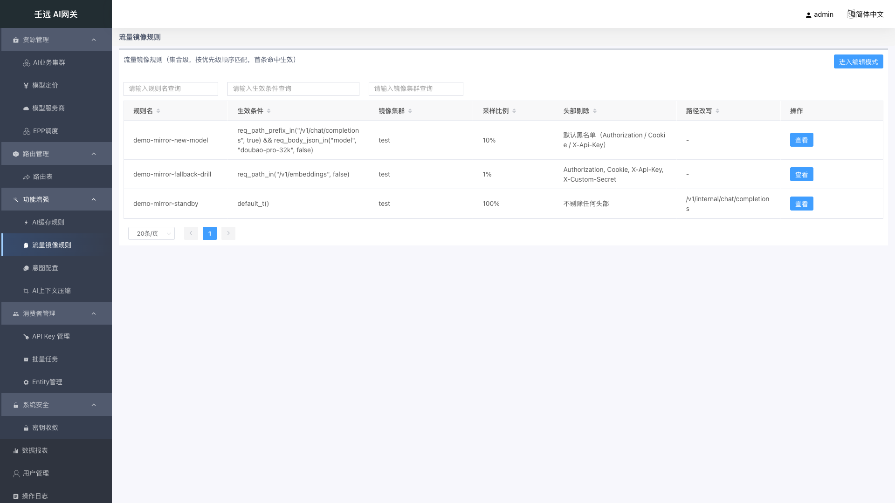
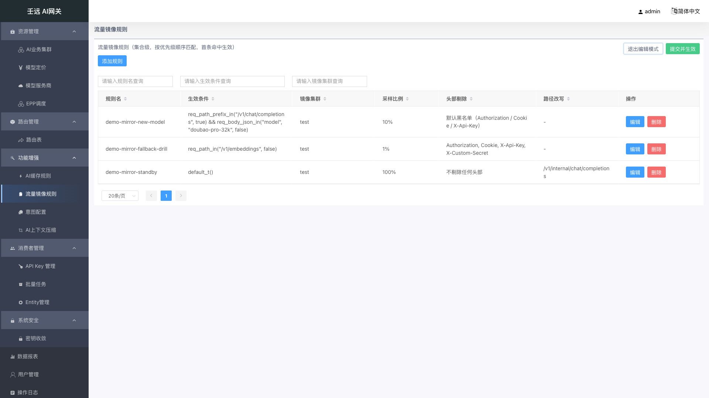
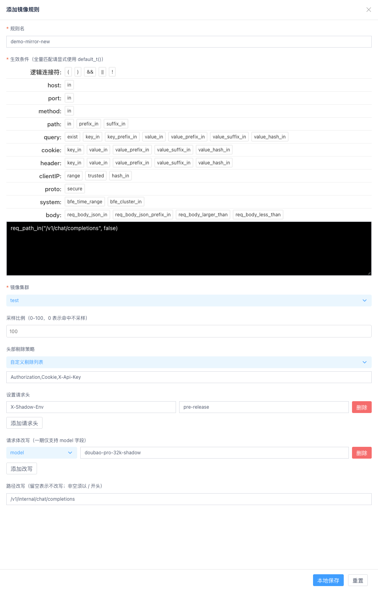
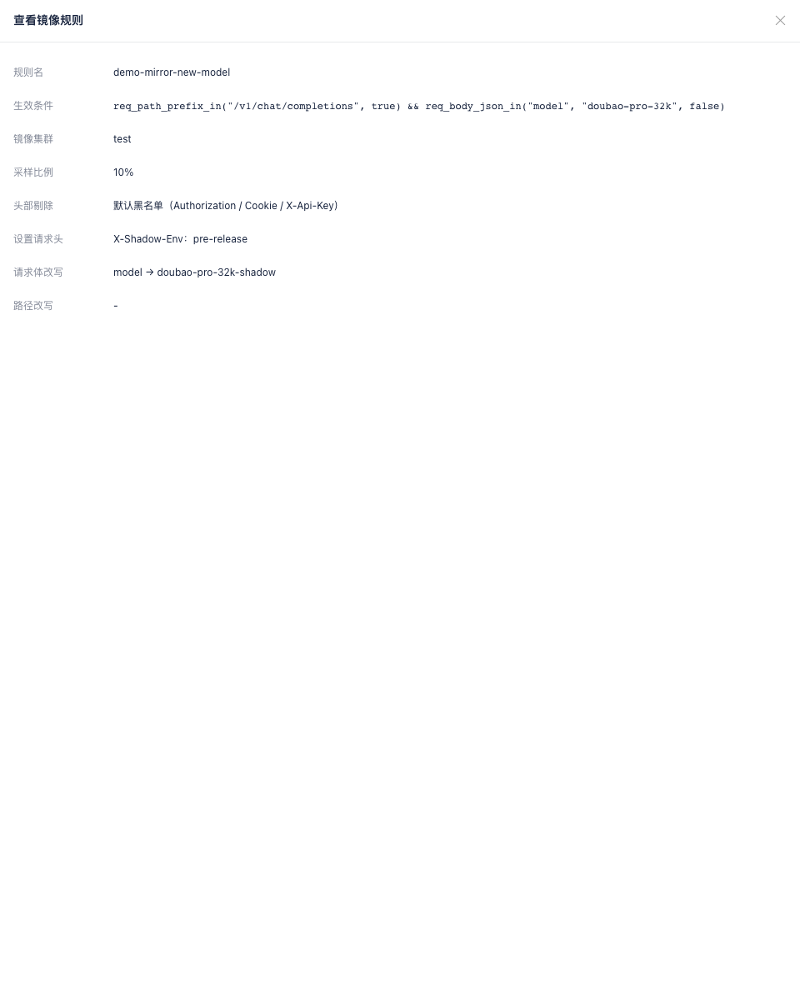

# 09 功能增强：流量镜像规则

**流量镜像（shadow traffic）**把生产请求的**副本**异步发往镜像目标集群：生产请求照常转发，副本的响应读空丢弃、只入统计（报表中的「镜像命中」，见 [17 章](17-report.md)）。镜像请求是网关内部的子请求——不扣配额、不重复鉴权、不计入客户用量，访问日志以 `mirror_hit` / `mirror_cluster` 标识命中情况。典型用途是新模型上线前的**双跑验证**、故障演练与兜底链路压测。

**入口**：功能增强 → 流量镜像规则（页面路由名 `TrafficMirrorRule.list`）。

这个页面没有「单条规则」的增删改接口：整组规则是一个**集合**，页面由 **1 个规则列表 + 2 个抽屉**构成（查看抽屉、添加/编辑抽屉），没有页签、没有独立详情页、也没有全局设置项。所有增删改先在页面内存里完成，最后用「提交并生效」把**整组规则一次性写回**（`PUT /traffic-mirror-rules`），数组顺序即优先级，**首条命中生效**（first-match-wins）。

- **集合语义**：规则没有 `enabled` 字段。删除规则 = 从集合移除后再提交；单条规则临时停用 = 采样比例填 `0`（命中但不采样）；提交 `{"rules": []}` = **镜像总开关关闭**。
- **依赖**：镜像目标集群需先在「AI业务集群」中创建（见 [03 章](03-ai-business-cluster.md)）；下拉选项来自 `GET clusters` 的集群名。
- **生效时延**：提交成功后，规则经 conf-agent 轮询 + BFE 热加载下发，镜像流量不会立即变化。

## 9.1 列表页

进入页面后默认处于**视图模式**：页面左上为标题「流量镜像规则（集合级，按优先级顺序匹配，首条命中生效）」，右上角仅一个「进入编辑模式」按钮；表格按接口返回的数组顺序展示规则（顺序即优先级）。

**表格列说明**：

| 列名 | 取值 / 展示 | 支持搜索 | 支持排序 |
| --- | --- | --- | --- |
| 规则名称 | 规则标识；为空显示 `-` | 是 | 是 |
| 生效条件 | BFE 条件表达式原文；为空显示 `-` | 是 | 是 |
| 镜像集群 | 镜像目标集群名；为空显示 `-` | 是 | 是 |
| 采样比例 | 按 `{值}%` 展示（如 `10%`、`0%`）；接口缺省 `null` 时显示 `-` | 否 | 是 |
| 头部剔除 | 三态文案，见下方说明 | 否 | 是 |
| 路径改写 | 改写后的完整路径；为空串或缺省显示 `-` | 否 | 是 |
| 操作 | 视图模式仅「查看」；编辑模式为「编辑」「删除」 | 否 | 否（列头不可排序） |

**头部剔除列的三态文案**（同一份数据有三种含义，肉眼必须能区分）：

| 接口取值 | 列表 / 查看抽屉文案 | 含义 |
| --- | --- | --- |
| 字段缺省（`null` / 未返回） | `默认黑名单（Authorization / Cookie / X-Api-Key）` | 服务端会填入默认黑名单，副本剔除这三个敏感头 |
| 显式空数组 `[]` | `不剔除任何头部` | 副本原样携带全部请求头（含鉴权头），慎用 |
| 非空数组 | 元素以 `,` 连接展示，如 `Authorization, Cookie, X-Api-Key, X-Custom-Secret` | 自定义剔除列表 |

**搜索与排序**：表格上方有独立的搜索行，仅「规则名称」「生效条件」「镜像集群」三列带输入框，占位文案分别为「请输入规则名称查询」「请输入生效条件查询」「请输入镜像集群查询」；多个输入框同时填写为**与**关系，匹配为**不区分大小写的包含匹配**，且为客户端过滤（不改变服务端集合顺序），搜索后自动回到第 1 页。点击可排序列的列头可切换升序 / 降序 / 取消排序，排序同样只影响当前展示，不会改变提交给服务端的规则顺序。

**分页**：客户端分页，默认每页 `20` 条，可在页码控件处切换 `20 / 30 / 40 / 50`。

**边界情况**：

- 集合为空（`{"rules": []}`）：表格无数据行，展示空态，页面无报错，右上角仍显示「进入编辑模式」；此时等于镜像总开关关闭。
- 列表加载失败（非 200 或网络异常）：弹出错误提示「加载流量镜像规则失败」，表格为空。

## 9.2 视图 / 编辑双模式与提交并生效

规则的新增、编辑、删除都必须在**编辑模式**下进行。注意这里有**两个「保存」步骤**，缺一不可：

| 步骤 | 操作 | 作用 | 是否影响线上 |
| --- | --- | --- | --- |
| 1 | 点击右上角「进入编辑模式」 | 进入可编辑状态，并对当前规则集合做快照 | 不影响 |
| 2 | 添加 / 编辑 / 删除规则 | 修改内存中的规则集合 | 不影响 |
| 3 | 在抽屉中点击「本地保存」 | 把本条规则暂存到列表里（仍只在浏览器内存中） | **仍不影响** |
| 4 | 点击右上角「提交并生效」 | 把整组规则一次性写回服务端（`PUT /traffic-mirror-rules`） | **正式生效** |

进入编辑模式后：左侧出现「添加规则」按钮，右上角变为「退出编辑模式」+「提交并生效」，行操作由「查看」变为「编辑」+「删除」。

**退出编辑模式**：

- 无未提交改动：直接回到视图模式并重新拉取列表，无弹窗。
- 有未提交改动：弹出信息提示「当前有未提交的改动，退出编辑模式将丢弃这些改动，确认退出？」。点「确定」丢弃改动、回滚到进入编辑模式时的快照并重新拉取列表，提示「已退出编辑模式」；点「取消」留在编辑模式，改动保留，提示「已取消退出」。

**提交并生效**：

- 提交前先做两次集合内查重（规则名称、生效条件），有重复直接拦截并提示，不发起请求。
- 提交期间按钮进入 loading 态（防重复提交）；请求体为 `{ rules: [...] }`，且**不含** `created_at` / `updated_at` 两个只读字段。
- 成功：提示「提交并生效成功！」，自动回到视图模式并重新 `GET` 列表（回填服务端生成的只读字段）。
- 失败（非 200 或异常）：提示「提交失败!」，**仍停留在编辑模式**，未提交的改动保留，可修正后重试。
- 服务端为**整组替换**：不在提交列表中的规则即被删除；任一校验失败则整体回滚，集合保持原状。

## 9.3 添加 / 编辑镜像规则

编辑模式下点击左上角「添加规则」，或在行操作点击「编辑」，右侧弹出抽屉（宽度约 60%）。抽屉标题为「添加镜像规则」或「编辑镜像规则」；表单抽屉点击遮罩**不会关闭**，需用抽屉右上角关闭图标或下方按钮结束操作。

**表单字段**：

| 字段 | 必填 | 默认值 | 校验规则 | 说明 |
| --- | --- | --- | --- | --- |
| 规则名称 | 是 | 空 | 1-128 字符（失焦校验，非输入框硬截断）；集合内不得重复 | 可读性 / 审计用，不是寻址键；占位「请输入规则名称，集合内唯一」 |
| 生效条件 | 是 | 空 | 必须能通过 BFE 条件编译；空串不接受；集合内不得重复 | 标签为「生效条件（全量匹配请显式使用 default_t()）」，用表达式构造器填写，命中即对该请求启用镜像 |
| 镜像集群 | 是 | 集群下拉首项（无集群时为空） | 下拉仅列 `GET clusters` 的集群名；服务端校验集群是否存在，不存在返回 422 | 镜像目标；鉴权凭证不在规则内配置 |
| 采样比例 | 是（前端校验） | `100` | `0`-`100` 的整数，输入框 `min=0` / `max=100` | 标签为「采样比例（0-100，0 表示命中不采样）」；留空会被校验拦截但输入框不显示必填星号；接口侧为非必填，未传时服务端按 `100` 处理 |
| 头部剔除策略 | 否 | 使用默认黑名单 | 选「自定义剔除列表」时，逗号分隔后不得全部为空 | 三态下拉，决定 `remove_headers` 的提交方式，见下表 |
| 设置请求头 | 否 | 空（空态「暂无设置请求头」） | 每行 key 与 value 去空格后均不能为空 | 注入镜像副本的自定义 Header；点「添加请求头」增行，行内「删除」减行；不建议配置 `X-Bfe-Mirror` |
| 请求体改写 | 否 | 空（空态「暂无请求体改写」） | `value` 去空格后不能为空；`path` 一期仅允许 `model` | 标签为「请求体改写（一期仅支持 model 字段）」；点「添加改写」增行，左侧路径为固定下拉 `model` |
| 路径改写 | 否 | 空（不改写） | 非空时必须以 `/` 开头 | 标签为「路径改写（留空表示不改写；非空须以 / 开头）」，占位 `/v1/chat/completions`；整体替换镜像路径，query 保留 |

> 表单上带必填星号的只有「规则名称」「生效条件」「镜像集群」三项；采样比例没有星号，但留空同样会被校验拦截（提示「采样比例必须为 0-100 的整数」）。

**头部剔除策略三态与提交行为**：

| 下拉选项 | 界面表现 | 提交时 | 服务端结果 |
| --- | --- | --- | --- |
| 使用默认黑名单 | 不显示自定义输入框 | **不携带** `remove_headers` 字段 | 由服务端填入 `["Authorization","Cookie","X-Api-Key"]` |
| 不剔除任何头部 | 不显示自定义输入框 | 携带 `remove_headers: []` | 副本不剔除任何头 |
| 自定义剔除列表 | 展开输入框，占位「逗号分隔，如 Authorization,Cookie」 | 携带拆分后的数组 | 按提交的列表剔除；列表全为空则拦截 |

> 「使用默认黑名单」与「自定义剔除列表里手写 `Authorization,Cookie,X-Api-Key`」在界面上看起来一样，但提交语义不同：前者留空交给服务端，后者是显式名单。

**底部按钮**：

- **本地保存**：校验通过后把本条规则写入列表（新增时插入集合**头部**，即新规则优先级最高），提示「添加成功！」或「保存成功！」；这一步**不发起任何网络请求**。
- **重置**：丢弃抽屉内当前填写内容，恢复为打开抽屉时的状态（新增时恢复为默认值）。

## 9.4 查看镜像规则

视图模式下点击行操作「查看」，右侧弹出只读抽屉（标题「查看镜像规则」，宽度约 60%，点击遮罩可关闭）。抽屉内**没有任何输入控件，也不显示必填星号**，只有 8 行文案：

| 信息行 | 展示内容 |
| --- | --- |
| 规则名称 | 规则名；为空显示 `-` |
| 生效条件 | 表达式原文，等宽字体展示；为空显示 `-` |
| 镜像集群 | 集群名；为空显示 `-` |
| 采样比例 | 按 `{值}%` 展示；接口缺省时按 `100%` 展示 |
| 头部剔除 | 三态文案（同 [9.1](#91-列表页) 表格） |
| 设置请求头 | 逐行 `名称：值`；无内容显示「无」 |
| 请求体改写 | 逐行 `path → value`；无内容显示「无」 |
| 路径改写 | 改写路径；为空串或缺省显示 `-` |

> 注意：查看抽屉对**缺省采样比例**按 `100%` 展示（服务端默认值），而列表的采样比例列对同样的缺省值显示 `-`。两者都是"接口未返回"的表现，不代表规则未生效。

## 9.5 删除规则与清空集合

编辑模式下点击行操作「删除」，弹出确认框「确认删除该镜像规则？删除后需提交并生效。」：点「确定」立即从列表移除并提示「删除成功!」，点「取消」提示「取消删除」。删除只作用于内存集合，**必须再点「提交并生效」才真正删除**。

**清空集合 = 关闭镜像总开关**：逐条删除至列表为空后提交，请求体为 `{"rules": []}`，语义是"不再镜像任何请求"，而不是删除集合本身。需要重新启用时，重新进入编辑模式新增规则并提交即可。

## 9.6 字段校验与错误提示

校验分两层：抽屉内 `RuleForm` 的表单校验（第一道，抽屉不关闭、不写入集合）与服务端接口约束（第二道兜底）。

| 字段 / 场景 | 校验规则 | 错误提示 |
| --- | --- | --- |
| 规则名称 | 去空格后非空 | `请输入规则名称` |
| 规则名称 | 长度不超过 128 字符 | `规则名称长度应为 1-128 字符` |
| 规则名称 | 集合内唯一（编辑时排除自身；本地保存与提交前各查一次） | `规则名称已存在，集合内必须唯一` |
| 生效条件 | 必填；表达式编译错误的提示优先于必填提示 | `请填写生效条件` |
| 生效条件 | 集合内唯一 | `生效条件重复，集合内必须唯一` |
| 镜像集群 | 必填 | `请选择镜像集群` |
| 镜像集群 | 服务端引用校验（集群不存在） | 接口返回 422 |
| 采样比例 | 空值或非 `0`-`100` | `采样比例必须为 0-100 的整数` |
| 头部剔除（自定义） | 逗号分隔后不得为空 | `自定义剔除列表不能为空` |
| 设置请求头 | 每行 key 与 value 均非空 | `设置请求头的名称与值均不能为空` |
| 请求体改写 | `value` 非空 | `请求体改写的值不能为空` |
| 路径改写 | 非空须以 `/` 开头 | `路径改写必须以 / 开头` |
| 表单整体 | 任一字段校验失败时点「本地保存」 | `请检查参数填写是否规范!` |

表单校验失败时抽屉保持打开、不写入集合；集合内查重失败时同样不发起提交请求。

## 9.7 注意事项

- **两个「保存」不是一回事**：抽屉里的「本地保存」只写进浏览器内存，**只有「提交并生效」才会下发到 BFE**；未提交就退出编辑模式，改动会被丢弃（有二次确认）。
- **没有启用 / 停用开关**：想临时停掉一条规则，把它的采样比例改成 `0`（命中但不采样），而不是删除；删除规则要连同提交一起做才生效。
- **数组顺序即优先级，且新增规则插到最前面**：新增规则会插入集合头部，因此它会**先于**已有规则命中（first-match-wins）。如果希望旧规则优先，在编辑模式下直接**拖拽规则行**调整顺序（列表下方有「拖动表格可修改生效次序」提示），顺序即优先级，无需借助其他字段。
- **全量匹配必须显式写 `default_t()`**：生效条件不接受空串，也不用"留空"表示全匹配；且同一集合内两条规则的生效条件不能相同——两条都写 `default_t()` 属于集合内重复，会被服务端 422 拒绝。全量镜像是双倍推理成本，建议先小比例（如 `1%`）验证。
- **头部剔除的"缺省"与"显式默认名单"不同**：选「使用默认黑名单」时提交体不带该字段，由服务端填默认黑名单；只有显式提交 `[]` 才是"不剔除任何头部"。若填自定义列表，请确认已剔除 `Authorization`、`Cookie`、`X-Api-Key` 等敏感头，避免凭证随副本流向镜像集群。
- **模块级参数不在此页配置**：镜像目标集群的鉴权凭证、分层超时 / 并发上限 / 熔断阈值由 BFE 静态配置下发，规则里只描述"哪些请求、按什么比例、发往哪个集群、怎么改写"；镜像流量不扣配额、不计用量，但确实会占用镜像集群的算力。配置变更会写入操作日志（详见 [18 章](18-operation-logs.md)）；该页只读，不提供手工录入入口。
