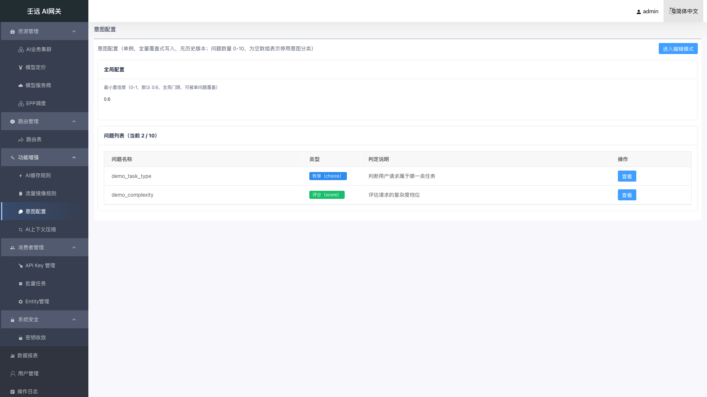
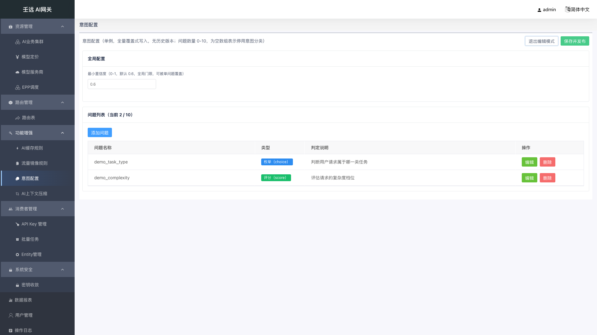
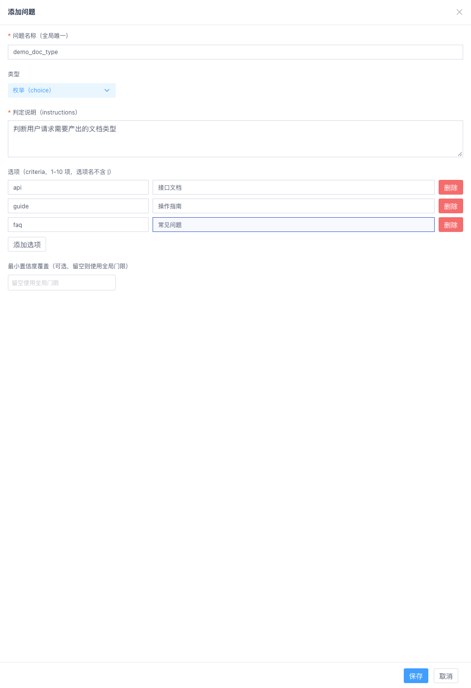
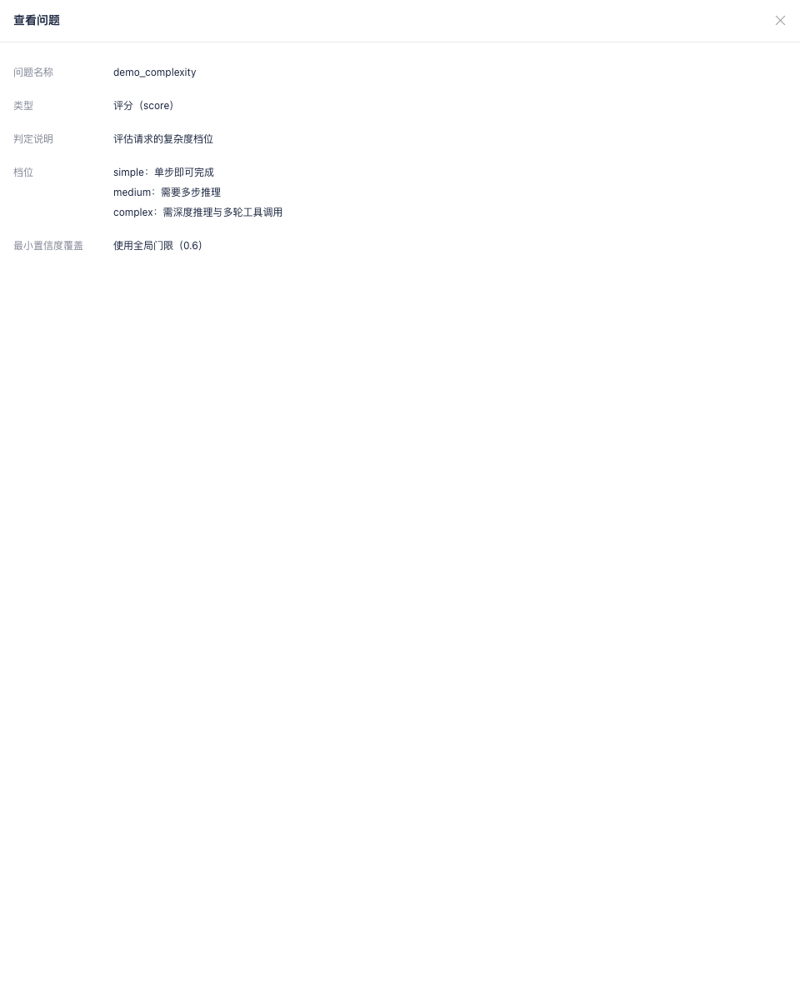

# 10 功能增强：意图配置

**入口**：功能增强 → 意图配置。

意图配置维护 AI 网关**意图分类**能力的配置：一组「问题」（问题集）与**置信度门控阈值**。数据面按问题集调用决策服务对请求做意图分类，路由规则的匹配条件再按「问题名 + 选项名 + 置信门槛」命中目标集群（条件原语 `req_ai_intent_in(...)`，写在路由规则表达式中）。因此这里的配置决定「意图条件能不能命中」——阈值调高会让更多答案被判为 `unknown`（不命中，流量走默认路由），问题集清空则等于整体停用意图分类。

**页面构成**：本模块是**单例配置页**，不是列表页。整页只有两块内容 —— 「全局配置」卡片（1 个字段）与「问题列表」卡片（1 个表格 + 编辑模式下表格上方的「添加问题」按钮），外加 1 个新增/编辑抽屉与 1 个只读查看抽屉。

| 区域 | 内容 | 视图模式 | 编辑模式 |
| --- | --- | --- | --- |
| 页头 | 页面描述 + 右上角操作按钮 | 「进入编辑模式」 | 「退出编辑模式」「保存并发布」 |
| 全局配置 | 最小置信度 | 纯文案展示 | 数字输入框 |
| 问题列表 | 表格（问题名称 / 类型 / 判定说明 / 操作） | 行操作仅「查看」 | 行操作「查看 / 编辑 / 删除」+ 表格上方「添加问题」 |
| 抽屉 | 新增/编辑问题、查看问题 | 仅可打开「查看问题」 | 可打开「添加问题」「编辑问题」「查看问题」 |

**首次使用**：从未发布过配置时（后端返回 404），页面直接渲染默认配置（最小置信度 `0.6`、问题列表为空）并**自动进入编辑模式**，顶部展示提示「意图配置尚未发布，当前展示的是默认配置，点击右上角「保存并发布」后生效。」，点击「保存并发布」即完成首次配置。

## 10.1 视图模式

页面加载时请求 `GET /intent-config`（权限：`FeatureAIIntent` + `ActionRead`），按响应进入两种状态之一：

| 响应 | 页面表现 |
| --- | --- |
| `200`（已发布过） | `published = true`，进入**视图模式**：全局阈值以纯文案展示、问题表格按返回值渲染、行操作仅「查看」，不展示「尚未发布」提示 |
| `404`（从未发布过） | `published = false`，渲染默认配置（阈值 `0.6`、问题列表为空）并**自动进入编辑模式**，顶部展示「尚未发布」蓝色提示条 |
| 其他（加载失败） | 提示「加载意图配置失败」，列表为空 |

已发布但 `questions` 为 `[]` 时接口**正常返回**（非 404），页面展示为空问题列表 —— 这是「已配置但停用意图分类」，不是「未配置」。

视图模式下页面只读：全局阈值以一段文本展示，问题列表卡片内不出现「添加问题」按钮，行操作列只有「查看」。

## 10.2 视图 / 编辑双模式

需要修改配置时，先点右上角「进入编辑模式」，再编辑，最后「保存并发布」。

| 步骤 | 操作 | 是否影响线上 |
| --- | --- | --- |
| 1 | 点击「进入编辑模式」（系统自动快照当前阈值与问题列表） | 不影响 |
| 2 | 修改全局阈值；添加 / 编辑 / 删除问题 | **仍不影响**（只改页面内的临时列表） |
| 3 | 点击「保存并发布」（整体 `PUT`） | **正式生效** |

- **进入编辑模式**：页头按钮变为「退出编辑模式」+「保存并发布」，全局阈值变为输入框，问题表格上方出现「添加问题」，行操作列变为「查看 / 编辑 / 删除」。
- **退出编辑模式**：把页面回滚为快照状态并重新拉取接口数据，回到视图模式。
- **退出确认**：若存在未保存的改动、点击「退出编辑模式」，弹出标题为「信息提示」的确认框，内容为「当前有未提交的改动，退出编辑模式将丢弃这些改动，确认退出？」。
  - 点「确定」→ 丢弃改动、回视图模式，提示「已退出编辑模式」。
  - 点「取消」→ 关闭确认框、保留改动继续编辑，提示「已取消退出」。
  - 若无任何改动，直接退出、不弹确认框。
- 「保存并发布」成功后自动回到视图模式（无需手动退出）。

## 10.3 全局配置：最小置信度

「全局配置」卡片只有一个字段。

| 字段 | 必填 | 默认值 | 校验规则 | 说明 |
| --- | --- | --- | --- | --- |
| 最小置信度（`min_confidence`） | 否 | `0.6` | 数字 `0`–`1`（输入框步进 `0.01`）；越界或非数字时提示「最小置信度必须为 0-1」 | 全局置信度门控阈值：决策服务给出的答案置信度**低于**该值时视为 `unknown`，路由中的意图条件不命中、流量走默认路由 |

- 视图模式下以纯文案展示（如 `0.6`），编辑模式下为数字输入框，占位提示 `0.6`。
- 该值是**全局门限**，可被单个问题的「最小置信度覆盖」逐条覆盖。
- 阈值越高越保守：误判减少，但更多请求被判 `unknown` 而落到默认路由；阈值越低越激进。

## 10.4 问题列表

「问题列表」卡片标题为「问题列表（当前 N / 10）」，实时显示当前问题数与上限。表格列固定为 4 列：

| 列名 | 说明 |
| --- | --- |
| 问题名称 | 问题标识（`name`），路由规则按它引用；为空时显示 `-` |
| 类型 | 以标签展示：`枚举（choice）`（蓝色）或 `评分（score）`（绿色） |
| 判定说明 | 发送给决策模型的自然语言说明（`instructions`）；为空时显示 `-` |
| 操作 | 视图模式仅「查看」；编辑模式为「编辑」「删除」 |

- **无分页**：问题数上限为 10，分页器被隐藏，全部问题在一屏内展示。
- 问题数量上限为 **10 个**；已满 10 个时点击「添加问题」会被拦截，提示「最多配置 10 个问题」。
- 列表以**数组顺序**提交，查看抽屉与提交体均按该顺序输出。顺序对 `choice` 无业务含义，但对 `score` 的「档位」是**从低到高**的语义顺序（见 [10.5 添加 / 编辑问题](#105-添加--编辑问题)）。

## 10.5 添加 / 编辑问题

编辑模式下点击「添加问题」（位于问题列表卡片内、表格上方左侧），或在行操作列点击「编辑」，右侧弹出宽 60% 的抽屉，标题分别为「添加问题」/「编辑问题」。

| 字段 | 必填 | 默认值 | 校验规则 | 说明 |
| --- | --- | --- | --- | --- |
| 问题名称（`name`） | 是 | 空 | 非空（忽略首尾空格）；**不超过 64 字符**；同一配置内**全局唯一** | 问题标识，路由规则中 `req_ai_intent_in("<name>", ...)` 按它引用。占位提示「如 task_type」 |
| 类型（`type`） | 是 | `枚举（choice）` | 下拉二选一：`choice` / `score` | 切换类型时自动清空另一侧集合（`choice` 用「选项」、`score` 用「档位」，两者互斥） |
| 判定说明（`instructions`） | 是 | 空 | 非空（忽略首尾空格） | 供决策模型参考的自然语言判定指令。占位提示「供分类模型参考的自然语言说明」 |
| 选项（`criteria`） | 类型为 `choice` 时必填 | 空（0 行，显示「暂无选项」） | `1`–`10` 行；每行选项名非空、唯一、**不能包含 `\|`** | 选项名 → 选项描述（键值对），提交为 `map<string,string>`。字段标签「选项（criteria，1-10 项，选项名不含 \|）」 |
| 档位（`levels`） | 类型为 `score` 时必填 | 空（0 行，显示「暂无档位」） | `1`–`10` 行；每行档位名非空、唯一 | **按从低到高**填写，提交为数组 `[{name, description}]`。字段标签「档位（levels，1-10 档，低→高）」 |
| 最小置信度覆盖（`min_confidence`） | 否 | 空（`null` = 使用全局门限） | 数字 `0`–`1`（步进 `0.01`） | 覆盖 [10.3 全局配置：最小置信度](#103-全局配置最小置信度) 的全局阈值；留空时该问题使用全局门限。字段标签「最小置信度覆盖（可选，留空则使用全局门限）」 |

**选项 / 档位的行操作**：

- 每行为「名称」「描述」两个输入框 + 一行「删除」按钮；名称占位提示「选项名」/「档位名」，描述占位提示「选项描述」/「档位描述」。
- 「添加选项」（`score` 时为「添加档位」）在列表下方新增一行空行；已达 10 行时点击提示「最多 10 项」。
- 描述**可以为空**；名称不可为空。
- 切换「类型」下拉后，字段标签、「添加」按钮文案、名称/描述占位提示会随之切换为「选项」或「档位」，并清空另一侧的已有行。

抽屉底部按钮：

- **保存**：先校验本抽屉内的问题（名称、判定说明、选项/档位数量与名称、阈值覆盖范围），并检查问题名称在本页问题列表中是否重复；通过后写入页面内的问题列表（**此时尚未提交到后端**），抽屉关闭并提示「已添加问题」或「已保存问题」。
- **取消**：关闭抽屉并丢弃本次填写，问题列表不变。

> 注意：新增/编辑抽屉**点击遮罩不能关闭**（`mask-closable = false`），必须点「保存」或「取消」。

## 10.6 查看问题（只读抽屉）

点击任意问题行的「查看」（视图模式与编辑模式均可用），右侧弹出标题为「查看问题」的只读抽屉（宽 60%，可点遮罩关闭），以纯文案展示该问题的全部字段：

| 展示项 | 内容 |
| --- | --- |
| 问题名称 | 该问题 `name`；为空显示 `-` |
| 类型 | `枚举（choice）` / `评分（score）` |
| 判定说明 | 该问题 `instructions`；为空显示 `-` |
| 选项 / 档位 | `choice` 显示「选项」、`score` 显示「档位」，逐行为「名称：描述」；描述为空时只显示名称；无内容时显示「暂无选项」/「暂无档位」 |
| 最小置信度覆盖 | 有覆盖值则显示该数值；未设置则显示「使用全局门限（0.6）」（括号内为当前全局阈值） |

该抽屉没有任何表单控件、没有必填星号、底部无按钮（footer 隐藏），纯展示。

## 10.7 保存并发布

编辑模式下点击右上角「保存并发布」，把**整份配置**以 `PUT /intent-config`（权限：`FeatureAIIntent` + `ActionUpdate`）一次性提交：

- **全量覆盖**：提交体即全量配置，`min_confidence` 与 `questions`（含每个问题的 `criteria` 或 `levels`、可选 `min_confidence`）一起提交；不存在单条/单字段更新接口。
- 提交体不含 `created_at` / `updated_at` 等只读字段，也不含内部版本号。
- 提交前先做整页校验（见 [10.8 校验规则与提示文案](#108-校验规则与提示文案)）；校验不通过则提示错误、不发起请求。
- 提交中按钮呈 loading 状态（防重复提交）。
- 成功后提示「保存并发布成功！」，页面自动回到视图模式并重新拉取 `GET /intent-config` 回填最新数据。
- 失败提示「提交失败!」（后端校验不通过同样走此提示）。

**停用意图分类的软开关**：把问题全部删除（提交 `questions: []`）即可停用意图分类 —— 数据面所有意图条件的答案恒为 `unknown`、`req_ai_intent_in(...)` 永不命中，流量回落默认路由。恢复时发布非空配置即可，**路由规则无需改动**。

## 10.8 校验规则与提示文案

整页校验在点击「保存并发布」时执行；问题抽屉内的校验在点击抽屉「保存」时执行。两者共用同一组文案：

| 字段 / 规则 | 约束 | 提示文案 |
| --- | --- | --- |
| 全局最小置信度 | 数值 `0`–`1` | `最小置信度必须为 0-1` |
| 问题数量 | `0`–`10` | `问题数量不能超过 10` |
| 添加问题（已达上限） | 最多 `10` 个 | `最多配置 10 个问题` |
| 问题名称 | 非空 | `请输入问题名称` |
| 问题名称 | 不超过 `64` 字符 | `问题名称不能超过 64 字符` |
| 问题名称 | 全局唯一 | `问题名称已存在，必须全局唯一` |
| 问题类型 | 只能是 `choice` / `score` | `类型非法` |
| 判定说明 | 非空 | `请填写判定说明` |
| 选项数量 | `1`–`10` 项 | `选项数量必须为 1-10` |
| 选项名 | 非空 | `选项名不能为空` |
| 选项名 | 不含 `\|` | `选项名不能包含 \|` |
| 选项名 | 不重复 | `选项名不能重复` |
| 档位数量 | `1`–`10` 档 | `档位数量必须为 1-10` |
| 档位名 | 非空 | `档位名不能为空` |
| 档位名 | 不重复 | `档位名不能重复` |
| 单问题最小置信度覆盖 | 数值 `0`–`1` | `最小置信度覆盖必须为 0-1` |
| 选项 / 档位行数（抽屉内添加） | 最多 `10` 行 | `最多 10 项` |
| 加载配置 | — | `加载意图配置失败` |
| 提交配置 | — | `提交失败!` |

## 10.9 运行时生效机制

- 配置下发链路：控制面 `PUT` 成功后生成新的**内部版本**（`yyyyMMddHHmmss`，冲突时顺延 1 秒），导出到数据面时字段转为 PascalCase（`Version` / `MinConfidence` / `Questions` 等）并落盘为 BFE 数据文件 `intent_questions.data`。
- 版本号**不在本页面与接口中暴露**：界面上看不到版本，也没有「历史版本 / 回滚」入口。需要回滚时，从操作日志或人工备份中找回旧内容，重新在页面上填写并「保存并发布」。
- **内容未变不触发热更**：`PUT` 的内容签名与当前一致时，导出结果为空，数据面既不落盘也不触发热加载。
- **生效时延**：由数据面轮询周期（`ReloadIntervalMs`）+ BFE 热加载时间决定，不是即时的；发布后若立即验证未生效，等待一个轮询周期后重试即可（轮询周期由部署环境配置）。
- **操作日志**：每次发布（含校验失败）都会记录一条操作日志，资源类型为 `intent_config`，`before` 快照取自库中现状；可在 [18 章 操作日志](18-operation-logs.md) 中查询。
- **与路由规则的关系**：本模块只维护问题集与阈值；路由规则中的意图条件由使用者在表达式里直接书写（`req_ai_intent_in("task_type", "coding|test_writing", 0.9)`，第 3 个参数可省略、省略时按问题/全局阈值门控），控制面不做「问题名是否已配置」的引用完整性校验 —— 问题名写错不会在此页报错，只会导致该条件永不命中。路由规则见 [07 章 路由管理](07-route.md)。
- **与报表的关系**：分类结果可在 [17 章 数据报表](17-report.md) 中观测（总览「意图分类」指标卡，明细「意图答案」列与 `ai_intent_question` / `ai_intent_answer` / `ai_intent_source` 等字段），用于判断阈值是否合适。

## 10.10 注意事项

- **两个「保存」不是一回事**：问题抽屉里的「保存」只把该问题写进页面列表，**不影响线上**；只有页头「保存并发布」才会提交到后端。在编辑模式改完问题后直接点「退出编辑模式」，即使确认框点「确定」，改动也会被丢弃。
- **全量覆盖写，没有局部更新**：每次「保存并发布」提交的都是整份配置，页面上看到的内容就是提交内容；后端不保留历史版本，误覆盖只能靠操作日志或人工备份找回旧内容重填。
- **`questions: []` ≠ 未配置**：空问题数组是「停用意图分类」的软开关（接口正常返回），而从未发布过时接口返回 `404`，页面会渲染默认配置并自动进入编辑模式。两者在页面上的表现完全不同，排查「意图条件为何不命中」时要先区分。
- **阈值是「低于则 unknown」**：全局 `min_confidence` 与单问题覆盖值都是**下限**判定，答案置信度低于阈值即被视为 `unknown`；调高阈值不会报错，但会让更多请求走默认路由，属于静默行为变化。
- **`choice` 与 `score` 的选项/档位互斥**：在抽屉里切换「类型」会**清空另一侧已填内容**（`criteria` ↔ `levels`）。切换后发现选项/档位空了属预期行为，不是页面故障。
- **选项名不能含 `|`**：数据面把选项名按 `|` 分隔拼接（`req_ai_intent_in("task_type", "coding|test_writing")`），因此 `choice` 的选项名禁止使用竖线；`score` 的档位名无此限制。
- **档位顺序由人工维护**：`score` 的「档位」按列表行顺序提交并解释为**从低到高**，页面不做自动排序；增删行后需自行确认顺序正确。
- **问题名称长度多了一道校验**：接口只要求非空，页面额外限制**不超过 64 字符**（超出即报错，不是输入截断）。
- **问题名称的软关联**：问题名被路由规则表达式按字符串引用，改名不会同步修改已有路由规则，也不会报错 —— 改名后必须手动更新相关路由规则的表达式。
- **查看抽屉可点遮罩关闭，新增/编辑抽屉不可**：新增/编辑抽屉必须点「保存」或「取消」结束；误点遮罩不会有任何反应，填写内容保留。
