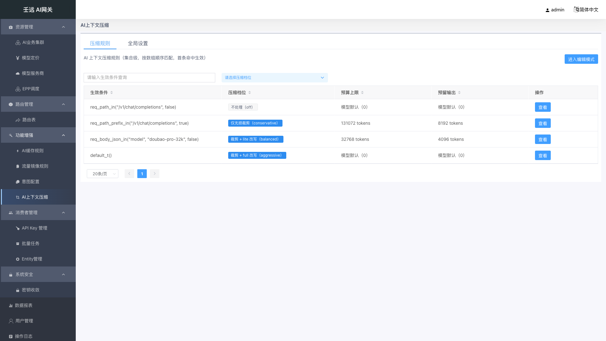
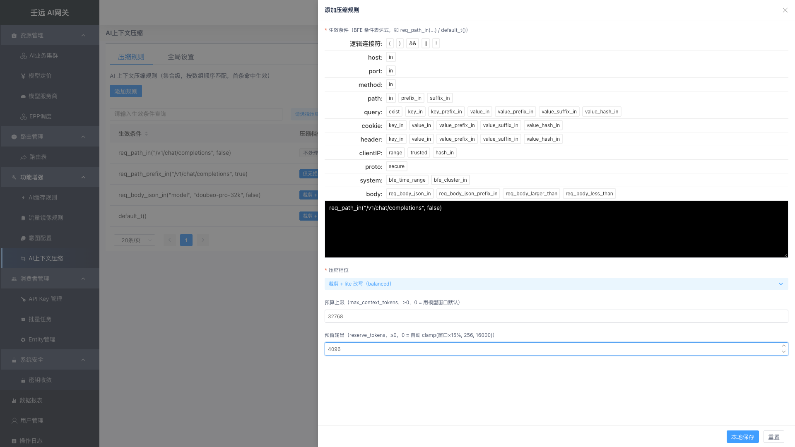
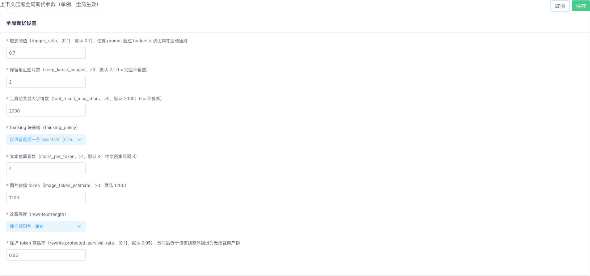

# 11 功能增强：AI上下文压缩

菜单路径：**功能增强 → AI上下文压缩**（页面路由 `ai-context-rules`，路由名 `AIContextRule.list`；在导航中为「功能增强」分组下的第 4 项，与 AI缓存规则、流量镜像规则、意图配置并列）。

页面为**单页双页签**结构，顶部有「压缩规则」与「全局设置」两个 Tab，两者对应两个**互相独立的接口**：

| Tab | 内容 | 接口 | 写语义 |
| --- | --- | --- | --- |
| 压缩规则 | 上下文压缩规则集合（列表 + 新增/编辑/查看抽屉） | `GET` / `PUT /ai-context-rules` | **整组替换**：提交的数组即生效集合，数组顺序即优先级 |
| 全局设置 | 裁剪层与改写层的全局调优参数（单例表单，8 个字段） | `GET` / `PUT /ai-context-settings` | **单例整行覆盖**：一行配置，全量保存 |

**这个模块解决什么问题**：长对话、长工具结果、多模态图片会让请求的 prompt 越来越大，既贵又容易超出模型上下文窗口。AI上下文压缩让你按请求（用条件表达式区分）选择压缩档位——从「只做无损裁剪（截断超长工具结果、丢弃旧图片、删除历史 thinking 块）」到「在此基础上再做规则改写」，并为全模块设定统一的估算系数、触发阈值与改写强度。配置保存后由 BFE 数据面的 `mod_ai_context` 模块执行，自动把超预算的请求压到预算以内再转发给模型。

> **前置说明**：本模块的**生效条件**使用 BFE 条件表达式，与 [07 章 路由管理](07-route.md) 的表达式构造器同源；压缩只作用于 OpenAI chat 协议请求（一期）。

## 11.1 压缩规则列表

进入 功能增强 → AI上下文压缩，默认停在「压缩规则」Tab。页签下方副标题为「AI 上下文压缩规则（集合级，按数组顺序匹配，首条命中生效）」。

**表格列说明**：

| 列名 | 说明 |
| --- | --- |
| 生效条件 | BFE 条件表达式，命中即对该请求按所选压缩档位处理；文本搜索列；等宽字体展示，空值显示 `-` |
| 压缩档位 | 以标签展示：`不处理（off）` / `仅无损裁剪（conservative）` / `裁剪 + lite 改写（balanced）` / `裁剪 + full 改写（aggressive）`；`off` 为默认色标签，其余为蓝色标签；下拉筛选（选项为裸枚举 `off` / `conservative` / `balanced` / `aggressive`） |
| 预算上限 | `max_context_tokens`。`0` 或未配置显示「模型默认（0）」，否则显示 `64000 tokens` |
| 预留输出 | `reserve_tokens`。`0` 或未配置显示「模型默认（0）」，否则显示 `8192 tokens` |
| 操作 | 视图模式：「查看」；编辑模式：「编辑」「删除」 |

- 四个数据列均支持**点击表头排序**（升序 → 降序 → 取消）；「生效条件」「压缩档位」支持筛选，筛选与排序均在**前端**对已拉取的集合进行（集合级接口无分页参数）。
- 表格自带分页器（每页 `20` 条，可选 `20 / 30 / 40 / 50`），数据量大时前端分页展示。
- 列表**不展示**名称、启用开关、优先级列，也没有「添加规则」之外的批量操作：规则**没有** `name`、`enabled`、`priority` 字段，**生效条件本身即规则身份**；「想禁用一条规则」= 把它从列表移除，或把它改成一条 `不处理（off）` 的兜底规则。
- 行的展示顺序就是接口返回的数组顺序，也就是匹配优先级顺序（首条命中生效），列表不做任何自动重排；**编辑模式下可直接拖拽行调整顺序**（列表下方有「拖动表格可修改生效次序」提示，鼠标移到行上会变成小手光标），表头排序仅为展示、不影响实际顺序。

### 视图模式 / 编辑模式

页面采用与路由规则一致的双模式：

| 模式 | 页头按钮 | 行操作 |
| --- | --- | --- |
| 视图模式（默认） | 「进入编辑模式」 | 「查看」 |
| 编辑模式 | 「添加规则」「退出编辑模式」「提交并生效」 | 「编辑」「删除」 |

- 点「进入编辑模式」后，系统先对当前集合做一份快照，所有增删改都只作用于**本地草稿**，不产生写请求。
- 点「退出编辑模式」时，若本地有未提交改动，会弹出二次确认「当前有未提交的改动，退出编辑模式将丢弃这些改动，确认退出？」；点「确定」回滚到快照并重新拉取集合（提示「已退出编辑模式」），点「取消」留在编辑模式且保留改动（提示「已取消退出」）。没有改动时直接退出，不弹确认框。

## 11.2 新增 / 编辑压缩规则

在编辑模式下点「添加规则」/ 行内「编辑」，右侧弹出宽度 60% 的抽屉，标题分别为「添加压缩规则」「编辑压缩规则」。

| 字段 | 必填 | 默认值 | 校验规则 | 说明 |
| --- | --- | --- | --- | --- |
| 生效条件 | 是 | 空 | 非空；须通过控制面**表达式编译校验**（非法表达式整体 422）；同一集合内**唯一** | 由条件表达式构造器填写，如 `req_path_in("/v1/chat/completions", false)`、`default_t()`。命中即按所选档位处理该请求；它同时是规则的唯一身份 |
| 压缩档位 | 是 | `off`（`不处理（off）`） | 四枚举之一：`off` / `conservative` / `balanced` / `aggressive` | `off` 不处理；`conservative` 仅无损裁剪（工具结果截断 / 旧图裁剪 / thinking 删除）；`balanced` 裁剪层 + lite 规则改写；`aggressive` 裁剪层 + full 规则改写 |
| 预算上限 | 否 | 空（等价 `0`，提交时**省略该字段**） | 整数且 `≥ 0` | `max_context_tokens`：把「可用预算的输入部分」显式钉死，替代模型窗口参与算式。`0` / 不填 = 使用模型窗口默认（数据面按模型名启发式，`128k` 兜底） |
| 预留输出 | 否 | 空（等价 `0`，提交时**省略该字段**） | 整数且 `≥ 0` | `reserve_tokens`：压缩目标 = `min(窗口, 预算上限) − 预留输出`，给应答留生长空间。`0` / 不填 = 自动 `clamp(窗口×15%, 256, 16000)` |

交互要点：

- 底部按钮为「本地保存」（主色）与「重置」。「重置」把表单恢复到打开抽屉时的状态（新增时为空白）。
- 「本地保存」只把这条规则写进**本地草稿集合**并关闭抽屉，提示「添加成功！」或「保存成功！」；**不会**发请求，必须再点页头「提交并生效」才落库生效。
- 新增的规则**插入到集合头部**（置顶），因此刚加的最高优先级规则会最先匹配；编辑模式下可直接**拖拽规则行**调整顺序，包括插到中间任意位置。
- 抽屉遮罩不可点击关闭（避免误丢草稿），需用右上角关闭按钮或「重置」后关闭。
- 生效条件在保存时会做集合内查重（编辑时排除自身），重复则拦截并提示「生效条件已存在，集合内必须唯一」。

## 11.3 查看压缩规则

在视图模式下点行内「查看」，右侧弹出只读抽屉，标题「查看压缩规则」，宽度 60%，点击遮罩可关闭。

抽屉以纯文案形式展示 4 项内容，**没有任何输入控件，也没有必填星号**：

| 展示项 | 展示规则 |
| --- | --- |
| 生效条件 | 等宽字体展示原表达式；为空显示 `-` |
| 压缩档位 | 本地化文案，如 `裁剪 + lite 改写（balanced）` |
| 预算上限 | `0` / 缺失显示「模型默认（0）」，否则显示 `xxx tokens` |
| 预留输出 | 同上 |

查看抽屉不产生任何写请求，也不校验字段；关闭后再查看另一条规则会完整替换内容，不会残留上一条的数据。

## 11.4 删除与清空规则

在编辑模式下点行内「删除」，弹出确认框（标题「信息提示」）：

> 确认删除该压缩规则？删除后需提交并生效。

- 点「确定」：该行从**本地草稿集合**中移除，提示「删除成功!」；点「取消」，集合不变，提示「取消删除」。
- 删除**只作用于本地草稿**，不发请求；必须点「提交并生效」才真正落库。若删除后直接「退出编辑模式」并确认丢弃改动，删除会被回滚。
- **清空全部规则**：在编辑模式下把所有规则逐条删除，再点「提交并生效」，提交体为 `{"rules": []}`，即清空整个集合。清空后数据面无规则命中，所有请求天然放行（不做任何压缩）。
- 删除**不会**影响「全局设置」Tab 的内容——两个接口互相独立，清空规则并不重置全局参数。

## 11.5 提交并生效

编辑模式下页头右上角的「提交并生效」是规则 Tab 的**唯一写入口**。点击后：

1. 先做提交前检查：剔除空生效条件后对全集合的生效条件做去重校验，命中重复直接拦截并提示「生效条件已存在，集合内必须唯一」，**不发送请求**。
2. 通过校验后向 `PUT /ai-context-rules` 发送 `{ "rules": [ ... ] }`，数组顺序即优先级；请求体中的规则不含创建时间 / 更新时间（接口也不返回这两个字段）。
3. 提交成功提示「提交并生效成功！」，页面自动回到**视图模式**并重新 `GET /ai-context-rules` 回填列表。
4. 提交失败提示「提交失败!」，并**停留在编辑模式**，本地改动不丢失，便于修正后重试。后端对任一元素校验失败会整体 422 且集合不变（生效条件不可编译、压缩档位非法、数值为负等）。

> **整组替换语义（最容易被忽略的一点）**：这个接口是「提交什么就是什么」，没有单条更新接口。**不在你提交列表里的规则即被删除**。因此多人同时编辑时，后提交者的集合会完整覆盖前者；建议改动前后都先看一遍列表，不要基于过期页面提交。

## 11.6 全局设置

切到「全局设置」Tab，副标题为「上下文压缩全局调优参数（单例，全局生效）」，下方 Cards 标题「全局调优设置」。视图态以 8 行纯文案展示；点页头「编辑」后变为可编辑表单（8 个控件，全部必填，label 前有红色 `*`），此时页头按钮变为「取消」「保存」。

| 字段 | 必填 | 默认值 | 校验规则 | 说明 |
| --- | --- | --- | --- | --- |
| 触发阈值 | 是 | `0.7` | 数值 `(0, 1]`（大于 0 且不超过 1） | `trigger_ratio`：估算 prompt token 超过 `预算 × 该比例` 才启动压缩，处理目标是压到 ≤ 预算 |
| 保留最近图片数 | 是 | `2` | 整数 `≥ 0` | `keep_latest_images`：多模态消息中的内联图片只保留最近 N 张，更旧的替换为占位文本；`0` = 完全不裁图（视图态显示「（完全不裁图）」） |
| 工具结果最大字符数 | 是 | `2000` | 整数 `≥ 0` | `tool_result_max_chars`：单条 tool/function 结果超限截断为「前段 + `...[truncated]`」；`0` = 不截断（视图态显示「（不截断）」） |
| thinking 块策略 | 是 | `trim-all-but-last` | 二枚举：`trim-all-but-last` / `keep` | `thinking_policy`：`仅保留最后一条 assistant（trim-all-but-last）` 删除除最后一条 assistant 外的所有 thinking 块；`保留全部（keep）` 不动 |
| 文本估算系数 | 是 | `4` | 整数 `≥ 1` | `chars_per_token`：字符/token 估算系数（与 BFE 既有惯例一致），中文密集场景可调小到 `3` |
| 图片估值 token | 是 | `1200` | 整数 `≥ 0` | `image_token_estimate`：单张内联 base64 图片的固定估值 token |
| 改写强度 | 是 | `lite` | 二枚举：`lite` / `full` | `rewrite.strength`：`保守规则包（lite）` / `激进规则包（full）`，仅 `balanced`、`aggressive` 档位的规则改写层会用到 |
| 保护 token 存活率 | 是 | `0.95` | 数值 `(0, 1]` | `rewrite.protected_survival_rate`：fidelity gate 阈值，改写后存活率低于该值则整体回退为无损裁剪产物（保安全） |

交互要点：

- 点「取消」**直接回滚**到进入编辑态时的快照，**没有二次确认**，且不发请求；未保存的改动被丢弃。
- 点「保存」会先做 8 项字段校验，失败时在对应控件下方内联报错并弹出「请检查参数填写是否规范!」，停留在编辑态；成功提示「全局设置保存成功！」，回到视图态并重新拉取设置回填。
- 保存请求体是完整的 8 字段结构化对象（后两项嵌套在 `rewrite` 下）；服务端执行单事务覆盖写。
- 「保存」按钮在请求期间显示 loading，防重复提交。
- 设置是**全系统单例**（一行配置）。若从未配置过，`GET /ai-context-settings` 仍返回上表默认值对象（HTTP 200），页面因此总是显示默认值而不是空白。
- 与规则集合**生命周期解耦**：设置独立保存，清空规则不影响设置，设置也随导出的 `Defaults` 块恒定下发。

## 11.7 校验规则与错误提示

**规则表单校验**（抽屉内，「本地保存」时触发）：

| 触发条件 | 提示文案 |
| --- | --- |
| 生效条件为空 | `请填写生效条件` |
| 生效条件表达式不可编译 | 由表达式校验接口返回的具体错误信息（优先于非空校验展示） |
| 生效条件与集合内其他规则重复 | `生效条件已存在，集合内必须唯一`（保存时与提交前各拦截一次） |
| 压缩档位非法 | `压缩档位不合法` |
| 预算上限 `< 0` | `预算上限不能小于 0` |
| 预留输出 `< 0` | `预留输出不能小于 0` |
| 任一字段校验失败 | 内联展示 + 整体提示 `请检查参数填写是否规范!` |

**全局设置校验**（点「保存」时触发）：

| 触发条件 | 提示文案 |
| --- | --- |
| 触发阈值 `≤ 0` 或 `> 1` | `触发阈值须大于 0 且不超过 1` |
| 保留最近图片数 `< 0` | `保留最近图片数不能小于 0` |
| 工具结果最大字符数 `< 0` | `工具结果最大字符数不能小于 0` |
| thinking 块策略非法 | `thinking 块策略不合法` |
| 文本估算系数 `< 1` | `文本估算系数不能小于 1` |
| 图片估值 token `< 0` | `图片估值 token 不能小于 0` |
| 改写强度非法 | `改写强度不合法` |
| 保护 token 存活率 `≤ 0` 或 `> 1` | `保护 token 存活率须大于 0 且不超过 1` |

**加载与提交失败**：列表加载失败提示「加载 AI 上下文压缩规则失败」，设置加载失败提示「加载 AI 上下文压缩设置失败」；提交失败提示「提交失败!」并保留当前编辑内容。

## 11.8 注意事项

- **`0` 不等于「不限制」，而是「交给模型窗口默认」**：预算上限与预留输出填 `0` 时，提交体会**省略该字段**，界面统一显示「模型默认（0）」，含义是「用模型窗口而不是某个固定 token 数」。需要精确预算（例如窗口未下发准确值）才填具体数字。
- **数组顺序即优先级，且整组覆盖**：没有优先级字段，`PUT` 提交什么就是什么，未提交的规则会被删除；新增规则默认置顶，编辑模式下可直接**拖拽规则行**调整顺序，包括插到中间任意位置。多人协作时注意覆盖风险。
- **生效条件即规则身份**：没有名称与启用开关，条件重复会被前端查重拦截；「停用一条规则」的正规做法是移除它，或保留一条 `default_t()` + `不处理（off）` 的兜底规则。
- **两个接口互不影响**：保存规则不会连带提交设置，反之亦然；清空规则集合也不会重置全局设置。改完规则记得单独确认设置是否符合预期。
- **设置页「取消」无二次确认**：与规则 Tab 的「退出编辑模式」不同，设置 Tab 点「取消」会立即丢弃未保存的改动，改动较多时请先确认。
- **生效有延迟，且是「提交」而非「保存」**：抽屉里的「本地保存」只改本地草稿；必须点页头「提交并生效」才写回控制面，之后还要经过 conf-agent 轮询周期 + BFE 热加载才真正生效。看到列表没变，先检查自己是不是漏点了「提交并生效」。
- **一期不支持的字段**：规则级 `override`、Defaults 内 `summary`、精确模型上下文窗口等二期能力暂不开放，界面不提供入口；数据面收到未知字段会忽略并计数告警，升级是平滑的。
