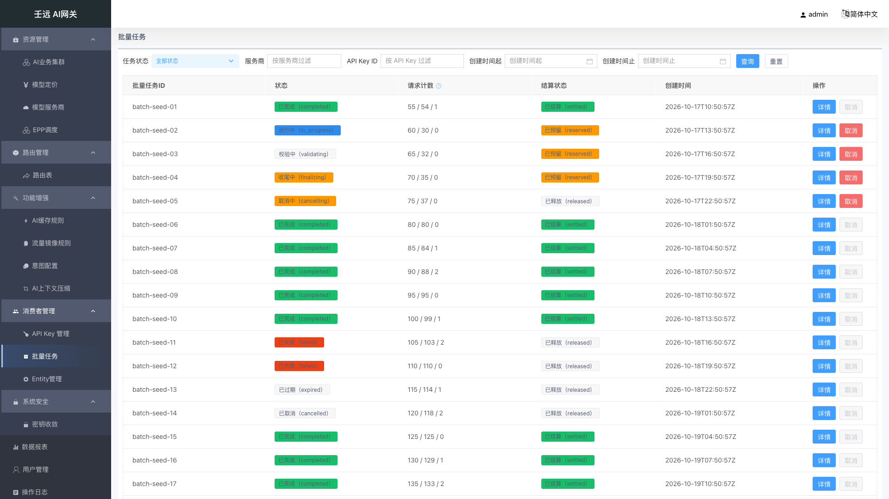

# 13 消费者管理：批量任务

批量任务用于管控**经数据面透传创建的 provider 原生批量任务**（OpenAI Batch API：`/v1/files` + `/v1/batches`）。控制台**只做管控，不做创建**：批量任务由调用方携带 API Key 直接向 provider 发起，数据面透传时做创建限流与金额预留 / 结算记账，控制台随后提供列表、详情、取消与文件元数据查询。

**入口**：侧栏「消费者管理 → 批量任务」（菜单 ID `BatchTask.list`，路由 `/batches`），位于「API Key 管理」之后、「Entity管理」之前。

**页面构成**：单一列表页（筛选栏 + 游标分页表格 + 底部「上一页 / 下一页」），**无页签、无全局设置、无「新建」入口**；点击「详情」在右侧打开抽屉（宽度 70%，5 个信息卡片 + 批量文件表格）；操作列的「取消」是本模块**唯一写操作**。

它解决的问题：让管理员看清每个批量任务归属哪个 API Key / Entity、进度如何（请求计数）、用了多少 token、预留与结算了多少金额，并在任务跑偏或不再需要时取消它、释放已预留的金额。

## 13.1 列表页

筛选栏从左到右为：任务状态（下拉）、服务商（输入框）、API Key ID（输入框）、创建时间起（日期时间选择器）、创建时间止（日期时间选择器）、「查询」、「重置」。所有条件均可选、可组合（AND 关系）。

表格列固定 12 列，末尾为「操作」列（「详情」+「取消」）。

### 筛选条件

| 字段 | 必填 | 默认值 | 校验规则 | 说明 |
| --- | --- | --- | --- | --- |
| 任务状态 | 否 | 全部状态 | 单值，须为 `status` 枚举之一 | 下拉框（可清空），对应请求参数 `status`；选「全部状态」时请求不携带该参数 |
| 服务商 | 否 | 空 | 文本，去除首尾空格后非空才提交 | 输入框，placeholder「按服务商过滤」，对应 `provider` |
| API Key ID | 否 | 空 | 文本，去除首尾空格后非空才提交 | 输入框，placeholder「按 API Key 过滤」；**按回车即触发查询**，也可点「查询」，对应 `api_key_id` |
| 创建时间起 | 否 | 空 | 日期时间，格式 `yyyy-MM-dd HH:mm:ss`，前端换算为秒级时间戳 | 对应 `start_time` |
| 创建时间止 | 否 | 空 | 同上 | 对应 `end_time`；与起始时间同时传入时按该**闭区间**过滤；只填一侧时按单边过滤，不报错 |
| 每页条数 | 否 | `20` | 接口取值范围 1-200，超出截断为 200 | 前端固定 `PAGE_LIMIT=20`，列表页**不提供**「20 / 50 / 100 条/页」切换；接口未传时默认 50 |
| 分页游标 | 否 | 首页不传 | 非空字符串 | 取上一页响应的 `next_cursor`，**不使用** `page` / `page_size` |

点击「查询」会**重置回首页游标**后重新请求；点击「重置」清空全部筛选条件并回到首页。

### 表格列

下表「字段」列即表格列名：

| 字段 | 必填 | 默认值 | 校验规则 | 说明 |
| --- | --- | --- | --- | --- |
| 批量任务ID | — | — | — | `batch_id`，provider 侧批量任务标识；同时是详情 / 取消的路径参数 |
| 服务商 | — | — | — | `provider` |
| API Key ID | — | — | — | `api_key_id`，发起该任务的网关 API Key |
| Entity ID | — | — | — | `entity_id`，任务归属实体 |
| 状态 | — | — | 枚举文案映射，未知值原样展示 | `status` 以 Tag 展示，文案形如「进行中（in_progress）」 |
| 请求计数 | — | `0 / 0 / 0` | 缺字段时按 `0` 兜底 | 展示 `request_counts` 的**总数 / 完成 / 失败**，形如 `100 / 98 / 2`；列表头带 `?` 帮助图标，提示「总数 / 完成 / 失败」 |
| 用量 | — | `0 / 0` | 缺字段时按 `0` 兜底 | 展示**输入 / 输出 tokens**，形如 `50000 / 12000`；表头帮助图标提示「输入 / 输出 tokens」 |
| 预留金额 | — | `-` | **1e-8 定点整数，原样展示，不做 ÷1e8 换算、不做格式化** | `reserve_units`（单位 RMB）；表头帮助图标提示「1e-8 定点整数 RMB，不做 ÷1e8 换算」 |
| 结算金额 | — | `-` | 同「预留金额」口径 | `settle_units`；未结算时为 `0` |
| 结算状态 | — | — | 枚举文案映射，未知值原样展示 | `settle_status` 以 Tag 展示：`reserved` → 「已预留」、`settled` → 「已结算」、`released` → 「已释放」 |
| 创建时间 | — | `-` | 直接展示接口返回的 RFC3339 字符串 | `created_at`，不做本地时区二次格式化 |
| 操作 | — | — | — | 「详情」按钮（主色）+「取消」按钮；终态任务「取消」置灰 |

空值（`null` / `undefined` / 空串）统一显示为 `-`。

### 翻页

列表底部右侧为「上一页」「下一页」两个按钮，采用**主键游标分页**（非页码分页）：

- 首页「上一页」置灰不可点；
- 响应 `next_cursor` 为空（空串）表示无更多数据，此时「下一页」置灰；
- 翻页按钮只受游标影响，**没有**「共 X 条 / 第 Y/Z 页」的页码信息；
- 翻页过程中若有新任务写入，不会造成记录重复或漏读（游标为主键游标）。

## 13.2 查看详情

在列表任意一行点击「详情」，右侧弹出抽屉，**标题为「批量任务详情」**、宽度 **70%**，并请求 `GET /batches/{batch_id}`。抽屉内为 5 个卡片：基本信息、状态与计数、用量与记账、文件与时间、批量文件。点击右上角 X 或抽屉外的遮罩均可关闭；关闭后列表数据不变。

**画面描述**（本图未生成，详见 [13.7 截图待补清单](#137-截图待补清单)）：抽屉自右向左覆盖约 70% 屏宽，顶部标题栏左侧写「批量任务详情」、右侧为关闭 X；标题栏下方自上而下排列 5 个卡片——「基本信息」（批量任务ID / 服务商 / API Key ID / 产品名称 / Entity ID / 透传端点）、「状态与计数」（状态 Tag + 请求总数 / 已完成请求数 / 失败请求数 / 估算行数）、「用量与记账」（输入 / 输出 token 数、用量来源、预留金额、结算金额、结算状态、预留结余、同步来源）、「文件与时间」（输入文件ID / 输出文件ID / 创建时间 / 更新时间 / 终结时间）、「批量文件」（6 列表格，含 `batch_input` 与 `batch_output` 两行，大小列形如 `1048576（1.00 MB）`）；抽屉背景半透明遮罩覆盖列表，列表本身不变化。

> 抽屉本身是**纯只读**的，不含任何写操作按钮。

### 基本信息

| 字段 | 必填 | 默认值 | 校验规则 | 说明 |
| --- | --- | --- | --- | --- |
| 批量任务ID | — | `-` | — | `batch_id` |
| 服务商 | — | `-` | — | `provider` |
| API Key ID | — | `-` | — | `api_key_id` |
| 产品名称 | — | `-` | 只读 | `product_name`，由认证中间件按调用凭证**强制注入**，不接受传参；字段名旁 `?` 提示「product_name，中间件强制注入，只读」 |
| Entity ID | — | `-` | — | `entity_id` |
| 透传端点 | — | `-` | — | `endpoint`，如 `/v1/batches` |

### 状态与计数

| 字段 | 必填 | 默认值 | 校验规则 | 说明 |
| --- | --- | --- | --- | --- |
| 状态 | — | `-` | 枚举文案映射 | `status`，Tag 展示（见 [13.4 状态与金额口径](#134-状态与金额口径)） |
| 请求总数 | — | `-` | — | `request_counts.total`；`?` 提示「request_counts.total」 |
| 已完成请求数 | — | `-` | — | `request_counts.completed` |
| 失败请求数 | — | `-` | — | `request_counts.failed` |
| 估算行数 | — | `-` | ≥ 0 | `est_lines`，按输入文件行数预估的请求行数 |

### 用量与记账

| 字段 | 必填 | 默认值 | 校验规则 | 说明 |
| --- | --- | --- | --- | --- |
| 输入 token 数 | — | `-` | ≥ 0 | `usage_input_tokens` |
| 输出 token 数 | — | `-` | ≥ 0 | `usage_output_tokens` |
| 用量来源 | — | `-` | 枚举 `download` / `reconcile` | `usage_source`；`?` 提示「usage_source：download=输出文件下载回读 / reconcile=对账」 |
| 预留金额 | — | `-` | 1e-8 定点整数，原样展示不换算 | `reserve_units`；`?` 提示「reserve_units，1e-8 定点整数 RMB，不做 ÷1e8 换算」 |
| 结算金额 | — | `-` | 同「预留金额」 | `settle_units`；未结算时为 `0` |
| 结算状态 | — | `-` | 枚举 `reserved` / `settled` / `released` | `settle_status`，Tag 展示 |
| 预留结余 | — | `-` | 布尔值原样展示（`true` / `false`） | `over_reserved`，预留金额 > 结算金额、结算后仍有剩余时为 `true`；`?` 提示「over_reserved，预留金额 > 结算金额 表示结算后仍有剩余」 |
| 同步来源 | — | `-` | 枚举 `redis` / `log` | `sync_source`；`?` 提示「sync_source：redis=BATCH_TASK 回源 / log=日志对账落库」 |

### 文件与时间

| 字段 | 必填 | 默认值 | 校验规则 | 说明 |
| --- | --- | --- | --- | --- |
| 输入文件ID | — | `-` | — | `input_file_id` |
| 输出文件ID | — | `-` | 未完成时为空 | `output_file_id`；`?` 提示「output_file_id，未完成时为空」 |
| 创建时间 | — | `-` | RFC3339 | `created_at` |
| 更新时间 | — | `-` | RFC3339 | `updated_at` |
| 终结时间 | — | `-` | 未终结为空 | `terminal_at`；`?` 提示「terminal_at，未终结为空」 |

### 批量文件

`batch_files` 以表格展示；为空数组或字段缺失时显示 `-`。

| 字段 | 必填 | 默认值 | 校验规则 | 说明 |
| --- | --- | --- | --- | --- |
| 文件ID | — | `-` | — | `file_id`，与「服务商」联合唯一定位文件（`GET /batch-files/{file_id}?provider=`） |
| 服务商 | — | `-` | — | `provider` |
| 用途 | — | `-` | provider 枚举，原样展示 | `purpose`，如 `batch_input` / `batch_output` |
| 文件名 | — | `-` | — | `filename` |
| 大小 | — | `0 B` | ≥ 0 | `bytes`，展示为「原始字节（格式化）」，例如 `1048576（1.00 MB）`；`?` 提示「bytes，单位字节」 |
| 创建时间 | — | `-` | RFC3339 | `created_at` |

> 若任务在 job 落库前被查看（`sync_source=redis`，即从 `BATCH_TASK` 回源），结算类字段可能尚未就绪，此时按空值展示为 `-`，**不视为异常**。

## 13.3 取消批量任务

对**非终态**任务，在操作列点击「取消」（红色）触发二次确认。

**画面描述**（本图未生成，详见 [13.7 截图待补清单](#137-截图待补清单)）：屏幕中央弹出小尺寸确认弹窗，标题行左侧写「提示」、右上角为关闭 X；正文一行 16 号灰字「确认取消批量任务 {batchId}？取消将调用 provider cancel 端点并释放金额预留。」；底部右对齐并排两个按钮——主色「确定」在右、默认色「取消」在左；弹窗背后为半透明遮罩，列表本身不变化。

- 确认弹窗标题为「提示」，正文为「确认取消批量任务 {batchId}？取消将调用 provider cancel 端点并释放金额预留。」（`{batchId}` 替换为实际 `batch_id`）；
- 点「确定」后发起 `POST /batches/{batch_id}/cancel`；成功后右上角提示「取消请求已受理，任务进入 cancelling 状态」，并**即时把该行状态更新为「取消中（cancelling）」、结算状态更新为「已释放（released）」**（以接口返回为准，接口未返回时按此默认值兜底）；
- 点「取消」（弹窗按钮）则不发起请求、任务状态不变。

**终态任务不可取消**：`completed` / `expired` / `failed` / `cancelled` 四种终态任务的「取消」按钮置灰不可点，悬停提示「终态任务不可取消」。

取消失败的提示对照：

| 提示 | 触发场景 | 处理建议 |
| --- | --- | --- |
| 任务已进入终态或正在被其它实例处理，取消未生效 | 接口返回 409：任务已进入终态，或另一实例正在处理（DB 条件更新抢占失败） | 刷新列表以服务端状态为准，不要按本地状态判断；若已终态则无需再取消 |
| provider 不可达，取消请求失败，请稍后重试 | 接口返回 502：控制面 → provider 出网调用失败 | 排查出网 / provider 可用性后重试；降级部署（无出网）时取消不可用，任务仅支持展示 |
| 批量任务不存在或已被清理 | 接口返回 404：任务 DB 与 Redis 均未命中，或不属于当前产品线 | 刷新列表 |
| 取消批量任务失败 | 其它未归类失败 | 记录 `batch_id` 后重试或联系运维 |

**前置依赖**：取消依赖控制面到 provider 的**出网可达**。无出网时该能力退化为不可用，批量任务仍可正常查看。

取消属写操作，会写入操作日志（`resource_type=batch`，记录操作者、目标 `batch_id` 与处理结果），可在「操作日志」中检索。

## 13.4 状态与金额口径

### 任务状态 `status`

| 取值 | 界面文案 | Tag 颜色语义 | 是否终态 |
| --- | --- | --- | --- |
| `validating` | 校验中（validating） | 中性（default） | 否 |
| `queued` | 排队中（queued） | 处理中（primary） | 否 |
| `in_progress` | 进行中（in_progress） | 处理中（primary） | 否 |
| `finalizing` | 收尾中（finalizing） | 告警（warning） | 否 |
| `cancelling` | 取消中（cancelling） | 告警（warning） | 否 |
| `completed` | 已完成（completed） | 成功（success） | **是** |
| `expired` | 已过期（expired） | 中性（default） | **是** |
| `failed` | 已失败（failed） | 异常（error） | **是** |
| `cancelled` | 已取消（cancelled） | 中性（default） | **是** |

状态流转与 provider Batch API 对齐：`validating` → `queued` → `in_progress` → `finalizing` → `completed` / `failed` / `expired` / `cancelled`；`cancelling` 是取消处理中的中间态，取消真正生效后由 provider 回调 / 同步流转为 `cancelled`。**终态集合 = `completed` / `expired` / `failed` / `cancelled`**，列表页据此决定「取消」是否置灰。

### 结算状态 `settle_status`

| 取值 | 界面文案 | 含义 |
| --- | --- | --- |
| `reserved` | 已预留（reserved） | 已按任务规模预留金额，尚未结算 |
| `settled` | 已结算（settled） | 已按实际用量结算 |
| `released` | 已释放（released） | 预留金额已释放（如任务取消） |

### 金额口径（重要）

`reserve_units` / `settle_units` 是 **1e-8 定点整数**，单位为 RMB（1 单位 = 0.00000001 元），口径与 RMB 配额、报表链路一致。界面**原样展示整数，不做 ÷1e8 换算、也不做小数格式化**：接口返回 `250000000` 就显示 `250000000`，请自行换算后再向业务方解释金额。

### 其它枚举

| 字段 | 取值 | 含义 |
| --- | --- | --- |
| `usage_source` | `download` | 用量经输出文件下载回读获得 |
| `usage_source` | `reconcile` | 用量经对账获得 |
| `sync_source` | `redis` | 该记录由 Redis `BATCH_TASK` 回源（job 落库前的窗口期，结算类字段可能未就绪） |
| `sync_source` | `log` | 该记录由日志对账落库 |

## 13.5 权限与审计

| 项目 | 说明 |
| --- | --- |
| 权限 Feature | `FeatureBatch`（批量任务功能开关），列表 / 详情 / 文件元数据查询共用 |
| Action（读） | `ActionRead`，用于列表、详情、批量文件元数据查询 |
| Action（写） | `ActionCancel`，仅用于取消；记录操作日志 |
| 产品线隔离 | `product_name` 由认证中间件强制注入，请求中携带一律忽略；只能看到本产品线数据 |
| 操作日志 | 取消任务写入操作日志，`resource_type=batch` |

接口错误码对照：

| 错误码 | 场景 | 页面表现 |
| --- | --- | --- |
| 401 | 未认证 / 凭证失效 | 由请求拦截器统一提示，页面不再重复提示 |
| 402 | 无 `FeatureBatch` 读（或取消）权限 | 同上；列表数据清空 |
| 422 | 列表参数非法（`status` / `limit` / 时间区间） | 同上；列表数据清空 |
| 404 | 任务 DB 与 Redis 均未命中，或不属于当前产品线 | 详情：提示「批量任务不存在或已被清理」；取消：提示同文案 |
| 409 | 取消时任务已终态或他实例处理中 | 提示「任务已进入终态或正在被其它实例处理，取消未生效」 |
| 502 | 取消时 provider 不可达（出网失败） | 提示「provider 不可达，取消请求失败，请稍后重试」 |

## 13.6 注意事项

- **页面上没有「新建」入口是设计如此**。批量任务只能由调用方携带 API Key 向 provider 的 `/v1/batches` 发起、经数据面透传创建；控制台一期只做管控。找不到「创建」按钮时不要当作缺陷。
- **金额是 1e-8 定点整数，界面不换算**。列表和详情中的预留 / 结算金额都是原始整数（如 `250000000` = 2.5 元），与「配额」「报表」的口径一致；任何除以 1e8 的换算都由使用者在外部完成。
- **预留结余（`over_reserved`）不是余额**。它只表示「预留金额 > 结算金额、结算后仍有剩余」这个布尔判断；`false` 也可能是未结算（`settle_status=reserved`），要结合结算状态一起看。
- **回源记录（`sync_source=redis`）字段可能未就绪**。这类任务是从 Redis 回源的、job 尚未落库，结算类字段（`settle_units` / `settle_status` / `terminal_at`）可能为空，界面显示 `-` 属正常，稍后再看即可。
- **取消不保证立即终结**。取消成功后任务进入 `cancelling`，要等 provider 侧真正取消后才流转为 `cancelled`；409 表示「任务已终态或正被其它实例处理」，此时以刷新后的服务端状态为准，不要按本地状态判断。
- **取消依赖控制面出网**。无出网的降级部署中，取消会返回 502、该能力不可用，但列表与详情查看不受影响。
- **列表筛选与接口参数不完全等价**：接口支持按 `entity_id` 过滤，但控制台列表**未提供** Entity ID 筛选框（仅提供状态、服务商、API Key ID、创建时间起止）；列表中展示的 Entity ID 只用于查看。
- **分页每页 20 条且不可切换**，且没有页码与总条数；只能按游标「上一页 / 下一页」浏览。若已翻到第 N 页，再点「查询」或「重置」会回到第一页。

## 13.7 截图待补清单

> 本章截图由 `ai-gateway-web-test/scripts/capture-docs-new-modules.js` 生成。
> 批量任务由数据面透传创建、控制台无创建入口，截取环境（本机控制台）`GET /batches` 返回空列表，
> 因此**列表截图只能拍到空态**，**详情与取消确认两张无法拍摄**（需要真实任务行才能打开抽屉 / 点「取消」）。

- `images/19-batch-tasks-list.png` — 批量任务列表页。**已生成，但为空态**：筛选栏（任务状态 / 服务商 / API Key ID / 创建时间起止 + 查询 / 重置）、12 列表头（含请求计数与用量的 `?` 帮助图标）、底部「上一页 / 下一页」完整可见；因环境无任务数据，表格显示「暂无数据」，**未能体现状态与结算状态 Tag、非零金额、非终态 / 终态两种行**。
- `images/19-batch-tasks-detail.png` — 批量任务详情抽屉：标题「批量任务详情」、宽度 70%，5 个卡片（基本信息 / 状态与计数 / 用量与记账 / 文件与时间 / 批量文件）完整可见，`batch_files` 表格含 `batch_input` 与 `batch_output` 两行、大小列显示「原始字节（格式化）」。**未生成**：环境中没有任务行，「详情」按钮无对象可点。
- `images/19-batch-tasks-cancel-confirm.png` — 取消二次确认弹窗：标题「提示」，正文「确认取消批量任务 <batch_id>？取消将调用 provider cancel 端点并释放金额预留。」，可见「确定 / 取消」按钮。**未生成**：环境中没有任务行，「取消」按钮无对象可点。

> 建议对照图：终态任务「取消」按钮置灰并悬停显示「终态任务不可取消」的局部特写；如需单列，可另存为 `images/19-batch-tasks-cancel-disabled.png`。**未生成**（同上：无任务数据）。
