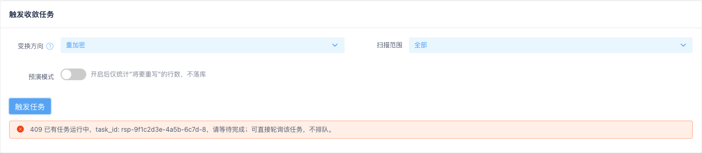
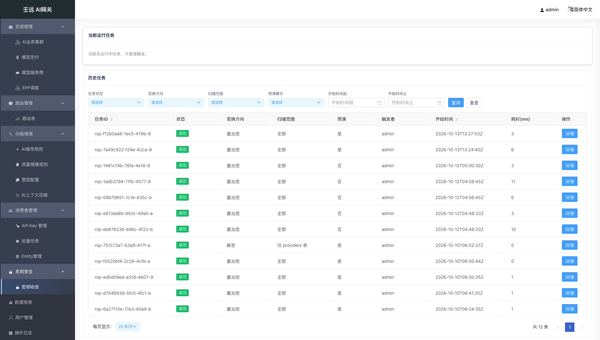
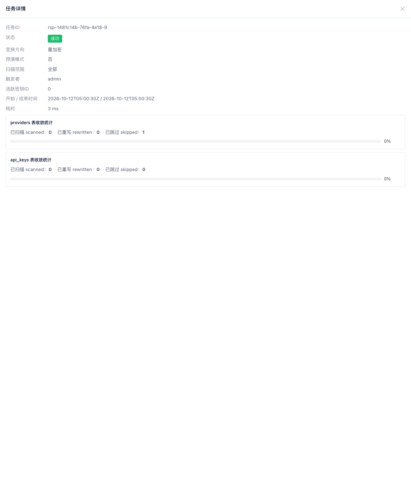
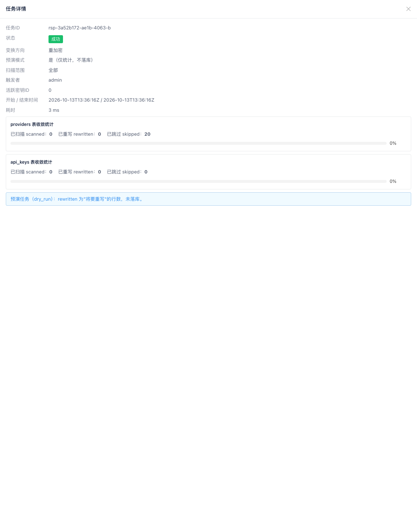

# 16 系统安全：密钥收敛

**入口**：侧栏「系统安全 → 密钥收敛」（路径 `/security`）。

密钥收敛用于对网关库内的**敏感密钥列**（服务商的服务鉴权 Key 所在 `providers` 表、API Key 所在 `api_keys` 表）执行批量的**重加密 / 解密**，使历史数据向当前加密形态（`keyring` 的 active 钥）收敛。任务**异步执行**：点击触发后立即返回并进入运行中状态，进度由页面按 800 毫秒轮询展示，完成后统计与耗时落库。历史任务记录服务端持久化、无过期清理，可按状态、方向、范围、预演与时间翻查。

页面为**单页三卡片**结构，无页签：

- **触发收敛任务**：变换方向、扫描范围、预演模式三个参数 + 「触发任务」按钮
- **当前运行任务**：展示由列表识别出的唯一运行中任务与其进度
- **历史任务**：筛选栏 + 服务端分页表格

点击历史表格中的「详情」，从右侧滑出 **60% 宽**的「任务详情」抽屉（点击遮罩或右上角关闭图标关闭）。

本模块属系统运维 / 安全类功能，需具备 `FeatureSecurity`（scope=System）权限的账号访问：无读权限时列表接口返回 402（`Feature Access Deny`），页面无法加载；无权限时菜单也不会出现。触发与查询接口本属同一功能权限，另分写（`update`）/ 读（`read`）两类动作。

## 16.1 触发收敛任务

页面顶部第一张卡片即触发区，可调参数：

| 字段 | 必填 | 默认值 | 校验规则 | 说明 |
| --- | --- | --- | --- | --- |
| 变换方向（`mode`） | 否 | `reencrypt`（重加密） | 仅 `reencrypt` / `decrypt` 两枚举 | `reencrypt`：明文行或旧 keyID 密文行重写为 active 钥密文；`decrypt`：全部密文行解密为明文，**仅用于回滚预案，日常禁止触发** |
| 扫描范围（`scope`） | 否 | `all`（全部） | 仅 `all` / `providers` / `api_keys` 三枚举 | `providers` 只扫服务商表、`api_keys` 只扫 API Key 表；下拉选项文案为「全部 / 仅 providers 表 / 仅 api_keys 表」 |
| 预演模式（`dry_run`） | 否 | 关闭（`false`，即「否」） | 布尔开关 | 开启后走 Switch 右侧提示「开启后仅统计"将要重写"的行数，不落库」，**不写库** |

- 「变换方向」标签右侧有蓝色帮助图标，悬停显示两个枚举的完整语义（含「日常禁止触发」提示）。
- 点击「触发任务」发起触发：按钮进入加载态，成功后弹出提示「任务已触发，task_id: {id}，轮询进度中」，**页码复位为第 1 页**并重新加载列表（新任务以「运行中」出现在列表首位），同时开始轮询该任务。
- 界面下拉为固定枚举，不存在非法值；绕过界面直接调接口传非法 `mode`/`scope` 时返回 **422**（字段级归因）。
- 集群级单例互斥：已有任务运行时触发会被拒绝，按钮下方出现红色提示条「409 已有任务运行中，task_id: {id}，请等待完成；可直接轮询该任务，不排队。」，并同时弹出同义提示；页面**不排队**，转而直接轮询该持有者任务。

## 16.2 当前运行任务

第二张卡片展示**唯一**的运行中任务，数据来自任务列表（`status=running` 项）；列表中没有运行中任务时显示「当前无运行中任务，可直接触发。」，且不发起轮询。

- 只要存在运行中任务，页面每 **800ms** 轮询一次单个任务查询接口（路径参数为该任务的 `task_id`），按 `task_id` 就地更新列表行、本卡片与已打开的详情抽屉，**不重置筛选条件、页码与排序，也不关闭抽屉**。
- 卡片内容与「任务详情」一致（字段见 [16.4 任务详情](#164-任务详情)），状态 Tag 后额外显示蓝色「轮询中…」文本。
- 运行中任务的统计与耗时尚未落库，卡片上耗时显示 `-`、统计区显示占位「任务运行中，统计将于完成后写入。」（**不显示**递增计数，也**不显示** `0 ms`）。
- 任务进入终态（成功 / 失败）后停止轮询、清空本地运行中对象，并立即重新拉取列表使统计与耗时落定，该卡片随之回到空态（或切换到下一个运行中任务，如果有）。

## 16.3 历史任务列表

第三张卡片由**筛选栏**与**服务端分页表格**组成：

### 筛选栏

任务状态、变换方向、扫描范围、预演模式四个下拉（默认项均为「全部」，不参与过滤），以及「开始时间起」「开始时间止」两个日期时间选择器（格式 `yyyy-MM-dd HH:mm:ss`，含边界），右侧为「查询」「重置」按钮。任一筛选项变更即自动重查列表并将页码复位为第 1 页；「查询」用于手动重查；「重置」清空全部筛选项、排序回落默认（`started_at` 倒序）并复位页码。

| 筛选项 | 对应接口参数 | 可选值 |
| --- | --- | --- |
| 任务状态 | `status` | 全部 / `running`（运行中）/ `succeeded`（成功）/ `failed`（失败） |
| 变换方向 | `mode` | 全部 / `reencrypt` / `decrypt` |
| 扫描范围 | `scope` | 全部 / `all` / `providers` / `api_keys` |
| 预演模式 | `dry_run` | 全部 / 是（`true`）/ 否（`false`） |
| 开始时间起 | `start_time` | 按下界（含）过滤 `started_at` |
| 开始时间止 | `end_time` | 按上界（含）过滤 `started_at`；早于起始时间时后端 422 归因 |

### 表格列

| 列名 | 说明 |
| --- | --- |
| 任务ID | `task_id`，原样完整展示；列头可排序 |
| 状态 | Tag 展示：运行中（蓝色）/ 成功（绿色）/ 失败（红色） |
| 变换方向 | `reencrypt` → 重加密、`decrypt` → 解密 |
| 扫描范围 | `all` → 全部、`providers` → 仅 providers 表、`api_keys` → 仅 api_keys 表 |
| 预演 | `dry_run` → 是 / 否 |
| 触发者 | `created_by`，未识别触发者时为空串，显示 `-` |
| 开始时间 | `started_at`，为空显示 `-`；列头可排序 |
| 耗时(ms) | 运行中显示 `-`（尚未落库）；终态显示实际毫秒数（`0` 也照实显示） |
| 操作 | 「详情」按钮，打开任务详情抽屉 |

- **运行中任务同样出现在列表中**，其统计 / 耗时 / 结束时间为库内已落库值（即空值与 0）。
- 分页为**服务端分页**：默认每页 **20** 条，可切换 20 / 50 / 100，底部展示总条数与页码，总数取过滤后的总记录数。
- 列头排序仅「任务ID」与「开始时间」提供（其余列不显示排序箭头）；若以其它列名发起排序请求，后端会忽略并回落为默认的 `started_at` 倒序。默认按开始时间从新到旧。
- 列表为空（含筛选无命中）时展示空态「暂无历史任务。」，不渲染表格。

## 16.4 任务详情

点击列表操作列「详情」打开右侧 60% 宽抽屉，标题为「任务详情」；运行中任务的横幅卡片复用同一套字段布局。

字段按固定顺序展示：

| 字段 | 必填 | 默认值 | 校验规则 | 说明 |
| --- | --- | --- | --- | --- |
| 任务ID（`task_id`） | —（系统生成） | `rsp-…` 前缀 | 非空 | 轮询与详情查询的路径参数 |
| 状态（`status`） | —（系统维护） | 触发后为 `running` | `running` / `succeeded` / `failed` | 运行中时状态 Tag 后附「轮询中…」 |
| 变换方向（`mode`） | — | 同触发入参 | `reencrypt` / `decrypt` | 界面显示「重加密 / 解密」 |
| 预演模式（`dry_run`） | — | 同触发入参 | `true` / `false` | 界面显示「是（仅统计，不落库）/ 否」 |
| 扫描范围（`scope`） | — | 同触发入参 | `all` / `providers` / `api_keys` | 决定下方渲染哪几张统计块 |
| 触发者（`created_by`） | —（系统记录） | 未识别时为空串 | 字符串 | 空串显示 `-`；触发（POST）响应不含该字段 |
| 活跃密钥ID（`active_key_id`） | —（系统记录） | `decrypt` 模式为 `0` | 0–255 整数 | 任务启动时 `keyring` 的 active 钥，可用于核对「重写目标钥」 |
| 开始 / 结束时间（`started_at` / `finished_at`） | —（系统维护） | 运行中 `finished_at` 为空 | RFC3339 时间串 | 界面以「开始 / 结束时间」一行展示，空值显示 `-` |
| 耗时（`duration_ms`） | —（完成时写入） | 运行中为 `0` | ≥0 整数 | 运行中显示 `-`；终态显示 `{ms} ms` |
| 统计（`summary`） | —（完成时落库） | 运行中为空对象 `{}` | 按表分组：`providers` / `api_keys`，各含 `scanned` / `rewritten` / `skipped` | 运行中显示占位「任务运行中，统计将于完成后写入。」 |
| 错误（`error`） | — | 空串 | `failed` 时为归因错误；预演成功任务固定为 `dry_run` | 不含任何密钥或密文材料 |

### 统计块

统计按扫描范围渲染，一次最多两张：

- **providers 表收敛统计**：`scope` 为 `all` / `providers` 时展示
- **api_keys 表收敛统计**：`scope` 为 `all` / `api_keys` 时展示

每张统计块包含三个计数与一条进度条：

| 计数 | 说明 |
| --- | --- |
| 已扫描 `scanned` | 已扫描的行数 |
| 已重写 `rewritten` | 已重写的行数；预演模式下为「将要重写」的行数 |
| 已跳过 `skipped` | 已是目标形态的行数（`reencrypt`：已是 active-keyID 密文；`decrypt`：已是明文） |

进度条表示「已扫描」在「已扫描 + 已跳过」中的占比（`scanned / (scanned + skipped)`），两者之和为 0 时进度为 0。

### 错误与预演提示

抽屉底部按 `error` 分三种情况，互斥展示：

- `error = dry_run`：**预演任务的成功语义标记**，以浅蓝底提示展示「预演任务（dry_run）：rewritten 为"将要重写"的行数，未落库。」，**不**走红色告警
- 其他非空 `error`（如 `executor lost`，表示执行实例失联被接管）：红色告警条展示「错误：{error}」
- `error` 为空：不展示任何提示

## 16.5 注意事项

- **`decrypt` 只用于回滚预案**：该方向会把全部密文行还原成明文，日常禁止触发；一旦使用，任务详情中的「活跃密钥ID」显示为 `0`（不代表第 0 把钥）。
- **预演的「已重写」不是真写入**：`dry_run` 开启时 `rewritten` 表示「将要重写」的行数，库内密文形态不变；预演任务完成后状态是**成功**、`error` 固定为 `dry_run`，页面用蓝色提示而非红色告警——看到红色「错误：dry_run」式的理解是错的。
- **运行中任务的 0 与空值不是真实结果**：运行中 `summary` 为空对象、`duration_ms` 为 0、`finished_at` 为空，页面统一显示占位文案与 `-`；不要据此判断「耗时 0 毫秒」或「统计为 0 条」，等状态翻转为成功 / 失败后再看统计。
- **集群级单例互斥且不排队**：任一时刻只允许一个收敛任务运行。运行中重复触发直接返回 409，提示中带持有者 `task_id`，页面转为直接轮询该任务；没有队列，也不必反复点击「触发任务」。
- **只有两列能排序**：列表排序字段仅「任务ID」与「开始时间」，其余列即便发起排序请求也会回落为默认的开始时间倒序；时间过滤按开始时间，上下界均含，结束早于开始时由后端返回 422 并由拦截器做字段级归因（页面不再重复弹出「加载任务失败」）。
- **幂等与接管**：任务完成后可重复触发，重触发后统计为 `rewritten=0` 即表示已收敛；若执行实例失联，后续触发会自动接管，旧任务被标记为 `error = executor lost` 的失败任务。历史记录持久化保存、无过期清理，可长期翻查。
