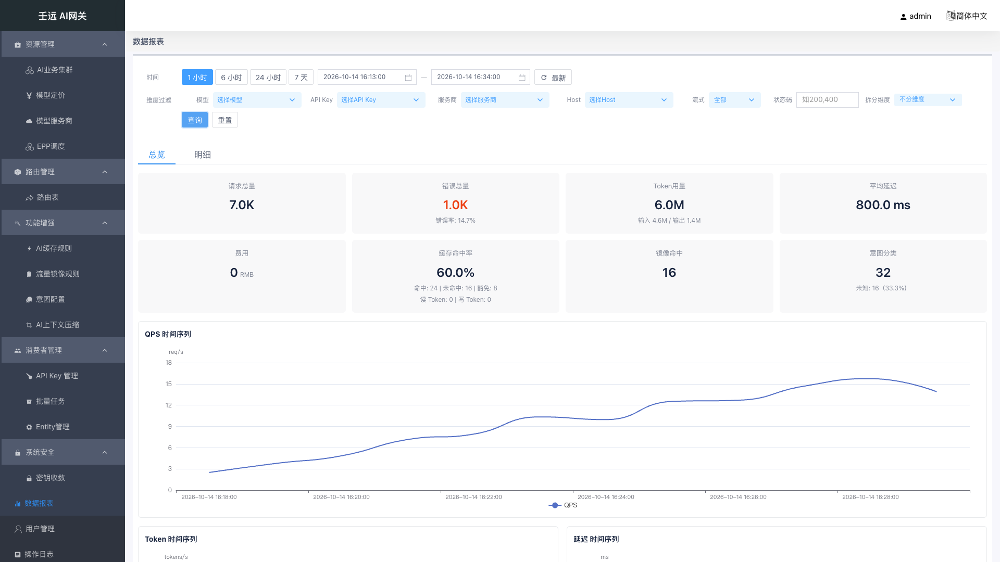
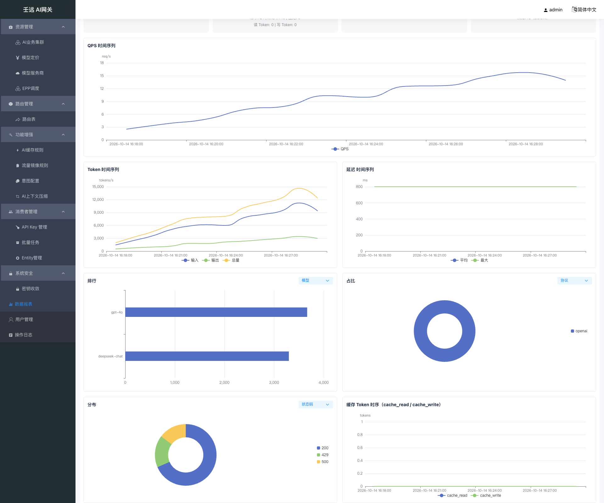
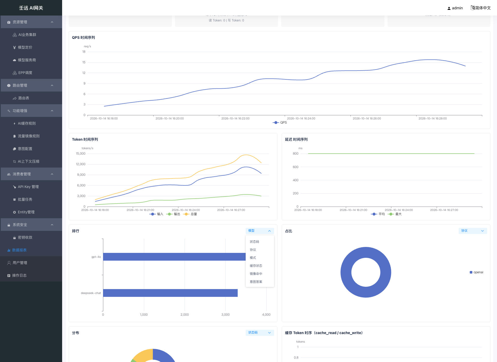
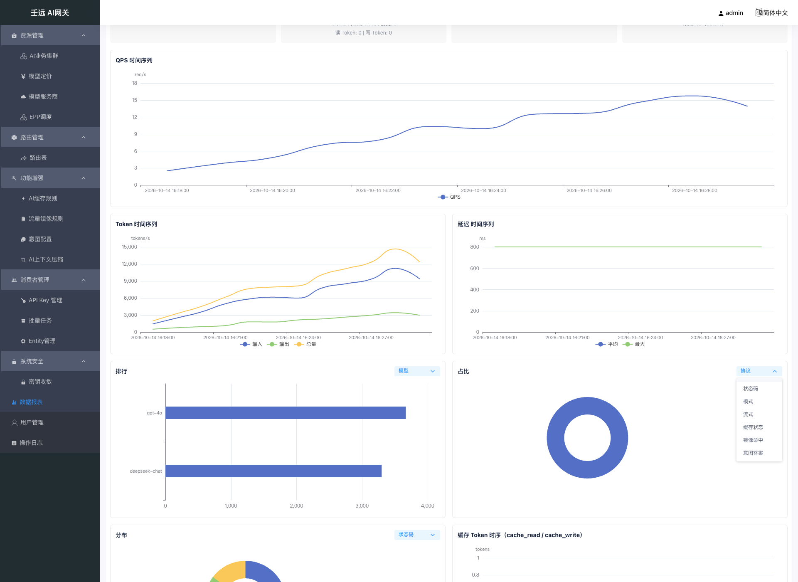
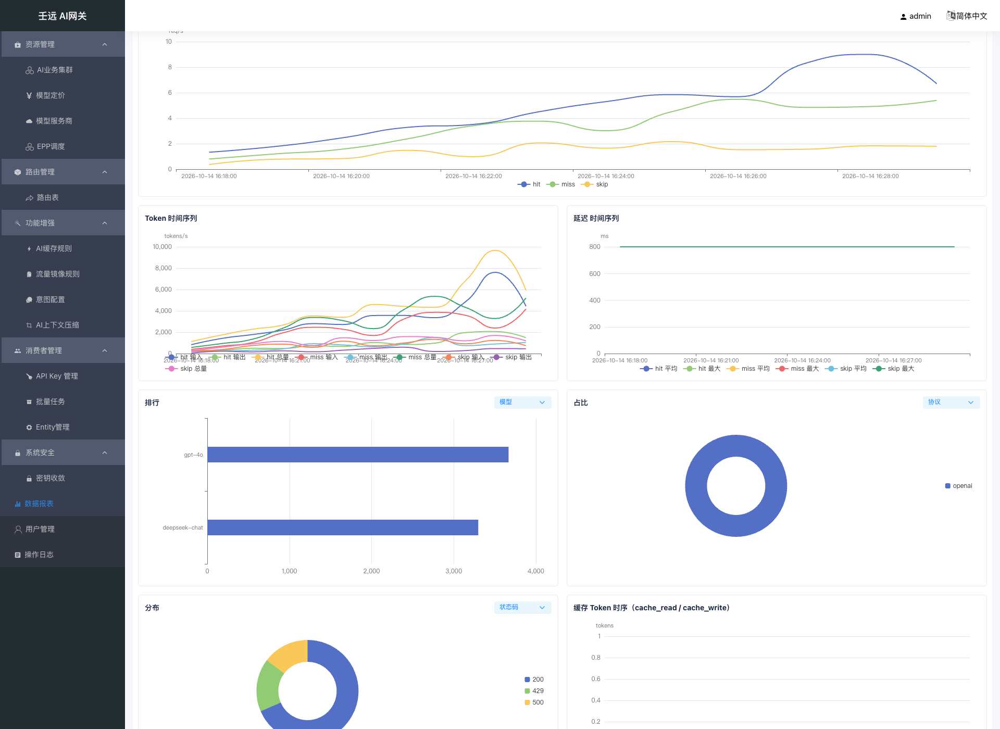
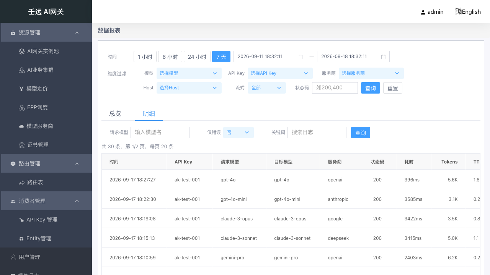
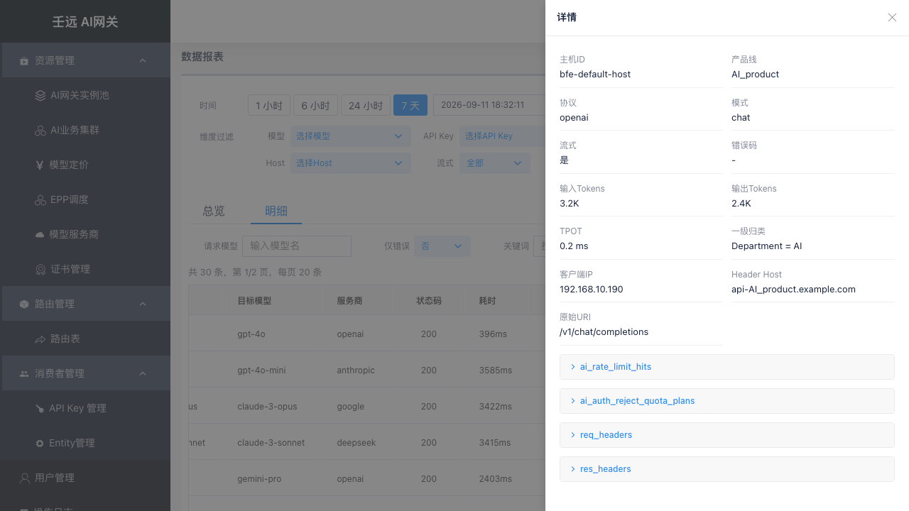

# 17 数据报表

数据报表提供网关运营数据的**可视化查询与分析**，包括总览指标卡、时序折线图、维度排行、占比分布与日志明细。查询后端由部署配置决定（MySQL 轻量形态，或 Doris / ClickHouse / StarRocks 标准形态），同一套界面多种后端结构一致。

**入口**：侧栏顶级菜单「数据报表」（路径 `/report`，路由名 `report.list`），菜单下无子项。

**页面性质**：本模块为**纯只读查询页，无写操作与编辑模式** —— 页面上没有新增 / 编辑 / 删除 / 提交等任何写入口，也不存在「视图 / 编辑」双模式切换；页面只调用 5 个只读查询接口，不产生配置变更，因此也不写操作日志。

## 17.1 页面结构

页面分为**全局过滤栏**和**页签区域**两部分：

| 区域 | 内容 | 说明 |
| --- | --- | --- |
| 全局过滤栏 | 两行分区：时间（快捷按钮 + 起止时间 + 「最新」）／维度过滤（6 个通用过滤项 + 行尾「拆分维度」+ 「查询」「重置」） | 过滤条件在页签之间共享，切换页签后保持 |
| 页签区域 | **总览** + **明细**（2 个页签） | 默认激活「总览」；页签以隐藏（`visibility`）方式常驻，切回时重新取数 |

- 进入页面即按默认窗口（近 1 小时）加载「总览」页签；「明细」页签在首次切换过去时才发起查询。
- 过滤栏的维度下拉选项不是静态字典，而是用当前时间窗口调排行接口（`model` / `apikey` / `provider` / `host`，各取前 50 名）动态填充，窗口内无数据的取值不会出现在下拉里。
- 行尾的「拆分维度」不是查询过滤项，而是**总览时序图的展示开关**（见 [17.2 全局过滤栏](#172-全局过滤栏)与 [17.4 总览页签：图表](#174-总览页签图表)）。
- 总览与明细的取数都基于同一份全局过滤参数（见 [17.2 全局过滤栏](#172-全局过滤栏)），明细另有各自工具栏过滤项（见 [17.6 明细页签：工具栏过滤](#176-明细页签工具栏过滤)）。

## 17.2 全局过滤栏

### 时间区

| 参数 | 类型 | 默认值 | 说明 |
| --- | --- | --- | --- |
| 快捷时间 | 按钮组（单选高亮） | 「1 小时」 | 4 个按钮：1 小时 / 6 小时 / 24 小时 / 7 天（即 1 / 6 / 24 / 168 小时）。点击后把结束时间置为当前时刻、起始时间置为「当前时刻 − 跨度」，并立即查询 |
| `start` | 时间选择器（`yyyy-MM-dd HH:mm:ss`，上送秒级时间戳） | 当前时刻 − 1 小时 | 界面标签「开始时间」；选择器按天禁用晚于结束时间、或早于「结束时间 − 7 天」的日期 |
| `end` | 时间选择器（同上） | 当前时刻 | 界面标签「结束时间」；按天禁用早于开始时间、或晚于「开始时间 + 7 天」的日期 |
| 「最新」 | 按钮 | — | 保持当前跨度不变，把窗口整体平移到当前时刻后重新查询 |

手动改动起止时间后，4 个快捷按钮取消高亮（避免误读为仍处于某个快捷窗口）。

### 维度区

维度区共 **7 个控件**：6 个通用过滤项（`models` / `apikey_ids` / `providers` / `hosts` / `stream` / `status_codes`，即接口文档 §1.1 的通用查询参数）+ 行尾的「拆分维度」。

| 参数 | 类型 | 默认值 | 说明 |
| --- | --- | --- | --- |
| `models` | 多选下拉（可搜索） | 空（全部） | 界面标签「目标模型」，对应**路由后的目标模型**（`ai_target_model`）；取值来自各集群实际支持的模型（`llm_config.models`），**不含**仅作为请求别名出现的模型名；选中值以 `,` 拼接上送，不选则不携带该参数 |
| `apikey_ids` | 多选下拉（可搜索） | 空（全部） | 界面标签「API Key」；取值来自排行维度 `apikey` |
| `providers` | 多选下拉（可搜索） | 空（全部） | 界面标签「服务商」，对应上游提供商；取值来自排行维度 `provider` |
| `hosts` | 多选下拉（可搜索） | 空（全部） | 界面标签「Host」，对应主机标识；取值来自排行维度 `host` |
| `stream` | 单选下拉（可清空） | 空（全部） | 界面标签「流式」，选项「是」= `1`、「否」= `0`（字符串取值，非布尔）；清空后不携带 |
| `status_codes` | 文本输入 | 空 | 界面标签「状态码」，逗号分隔多个，如 `200,500`；占位文案「如200,400」 |
| 拆分维度（`tsSplit`） | 单选下拉 | 「不分维度」（`''`） | 界面标签「拆分维度」，位于**状态码之后、查询按钮之前**；4 个选项：不分维度 / 缓存状态（`ai_cache_status`）/ 镜像命中（`mirror_hit`）/ 意图答案（`ai_intent_answer`）。**不是查询过滤参数**，不并入任何请求的通用过滤项，只决定总览 QPS / Token / 延迟三张时序图是否按维度桶拆成多条序列（见 [17.4 总览页签：图表](#174-总览页签图表)） |

- 7 个控件**行为一致**：选中后都需点击「查询」才生效，仅切换控件本身不会重新取数。
- 顶部过滤栏**没有**「缓存状态 / 镜像命中 / 意图答案」过滤项（2026-10-14 变更已从总览过滤栏移除这三个未接线的选择器）：这三个维度不是总览 / 时序的通用过滤参数，无法在总览按它们筛选。它们在本页的作用是**图表下钻维度**（排行图、占比 / 分布饼图的下拉项，以及时序图的「拆分维度」）；若要按它们过滤明细，请用明细工具栏的同名项（见 [17.6 明细页签：工具栏过滤](#176-明细页签工具栏过滤)）。

### 按钮与本地校验

| 按钮 | 行为 |
| --- | --- |
| 查询 | 先校验时间范围，再按**当前页签**重新取数（总览刷新指标卡与图表，并把当前「拆分维度」一并应用到三张时序图；明细刷新表格）。顶部「查询」**不会**把明细页码重置为第 1 页 |
| 重置 | 清空全部 **6 项**通用过滤项（4 个多选下拉置空，`stream` / `status_codes` 清空）并把「拆分维度」复位为「不分维度」，随即重新查询；**不改变时间范围与快捷按钮高亮**（重置不动查询窗口，避免同一按钮两次结果不一致） |

| 场景 | 前端行为 | 提示文案 |
| --- | --- | --- |
| 起止时间缺失或顺序错误（`end ≤ start`） | 拦截，不发起请求 | 查询时间范围不合法，请重新选择 |
| 跨度超过 7 天 | 拦截，不发起请求 | 查询时间跨度不能超过 7 天 |
| 跨度恰好等于 7 天 | 放行（上限含边界） | — |

## 17.3 总览页签：指标卡

总览顶部是 **8 张指标卡**（4 列 × 2 行网格，灰底圆角；错误总量卡数值为红色）：

| 指标卡 | 接口字段 | 口径 | 单位 / 格式 |
| --- | --- | --- | --- |
| 请求总量 | `request_total` | 窗口内请求数合计 | 个；`fmtNum`（≥ 1000 → `1.2K`，≥ 1000000 → `1.2M`，其余原样，空值 → `-`） |
| 错误总量 | `error_total` | 窗口内错误数合计（红色主值） | 个；`fmtNum`；副行「错误率: {error_rate}」为百分比 1 位小数 |
| Token用量 | `total_tokens` | 窗口内 Token 合计 | 个；`fmtNum`；副行「输入 {input_tokens} / 输出 {output_tokens}」 |
| 平均延迟 | `latency_avg_ms` | 窗口内平均请求耗时 | 毫秒；`{值} ms`（1 位小数） |
| 费用 | `cost[]` | 按币种分组的成本金额（服务端已把 1e-8 定点值换算为金额） | 主值 = 第一个币种的金额（`fmtNum`）+ 币种小字；其余币种逐行以「币种: 金额」列示；无成本数据时主值 `-` |
| 缓存命中率 | `cache.hit_rate` | `hit / (hit + miss)`，**豁免（`skip`）不计入分母**；分母为 0 时返回 0 | 百分比 1 位小数；副行 1「命中: {hit} \| 未命中: {miss} \| 豁免: {skip}」；副行 2「读 Token: {read_tokens} \| 写 Token: {write_tokens}」（读写 Token 为窗口合计，**未做 ÷1e8 换算**，与网关日志计量口径一致） |
| 镜像命中 | `mirror.hit_count` | 窗口内被流量镜像的请求数 | 个；`fmtNum`；口径与规则见 [09 章](09-traffic-mirror-rules.md#91-列表页) |
| 意图分类 | `intent.classified_count` | 窗口内路由**实际消费**的意图分类数（不是全部已配置问题的分类量） | 个；`fmtNum`；副行「未知: {unknown_count}（{unknown_rate}）」，`unknown_rate = unknown / (classified + unknown)`，分母为 0 时返回 0；口径见 [10 章](10-intent-config.md#103-全局配置最小置信度) |

- 缓存 / 镜像 / 意图三组计数的数据源与明细表一致（条件统计），因此在数据链路刚上线、字段尚未积累时，卡片可能为 0 或 `-`（见 [17.8 时间窗口、数据来源与口径](#178-时间窗口数据来源与口径) 的「数据可得性」）。
- 总览**不展示** P50 / P90 / P99 延迟，也不展示限流命中数与被拒绝配额计划数：分位数只有标准形态后端返回，界面固定只取平均值与最大值，不随后端变化。

## 17.4 总览页签：图表

图表区为 **2 列网格**（普通图卡高 280px，`.tall` 图卡高 320px），共 **7 张 echarts 图表**，自上而下、从左到右排列：

| 图表标题 | 图形 | 维度 / 指标 | 数据来源（请求） | 说明 |
| --- | --- | --- | --- | --- |
| QPS 时序 | 折线（整行通栏，高 320px） | 指标 QPS（`req/s`） | `/report/timeseries?metric=qps` | 默认单序列；「拆分维度」选中时带 `dimension` 返回多序列 |
| Token 时间序列 | 折线 | 输入 / 输出 / 总量（`tokens/s`） | `metric=tokens` | 默认三条序列取自同一点的 `input` / `output` / `total` |
| 延迟 时间序列 | 折线 | 平均 / 最大（`ms`） | `metric=latency` | 仅 `avg` / `max` 两条序列；分位数不在总览展示 |
| 排行 | 横向柱状（高 320px） | 标题旁**维度下拉**（默认模型），指标请求数 | `/report/rankings?dimension=<下拉值>&limit=10` | 取前 10 条，类目轴倒序（最大值在最上方） |
| 占比 | 饼图（环图） | 标题旁**维度下拉**（默认协议），指标请求数 | `/report/distribution?dimension=<下拉值>` | 占比 = 该维度值请求数 / 窗口请求总数 |
| 分布 | 饼图（环图） | 标题旁**维度下拉**（默认状态码），指标请求数 | `/report/distribution?dimension=<下拉值>` | 同上；空值维度归一为 `unknown` 桶 |
| 缓存 Token 时序 | 折线 | `cache_read` / `cache_write`（`tokens`） | `metric=cache_tokens` | 双序列按 `kind` 拆分，缺失点以占位显示；**不参与拆分维度** |

### 维度下拉（排行 / 占比 / 分布）

三张图的图卡标题旁各有一个维度下拉，位于标题右侧（标题本身不再写死维度，因此从「模型 Top10 排行 / 服务商分布 / 状态码分布」简化为「排行 / 占比 / 分布」）：

| 图表 | 下拉选项数 | 选项（i18n 文案） | 默认 |
| --- | --- | --- | --- |
| 排行 | **10 项** | 目标模型 / 服务商 / API Key / Host / 状态码 / 协议 / 模式 / 缓存状态 / 镜像命中 / 意图答案 | 目标模型（`model`） |
| 占比 | **7 项** | 协议 / 状态码 / 模式 / 流式 / 缓存状态 / 镜像命中 / 意图答案 | 协议（`protocol`） |
| 分布 | **7 项** | 与占比相同的 7 项，只是默认选中项不同 | 状态码（`status`） |

两个饼图的下拉在展开时会把**当前选中的维度排在下拉首位**（其余按固定顺序排列），所以同一张图的选项顺序会随选中值变化，选项集合不变。

- **切换即时生效**：改动维度下拉会立刻按新维度重新请求并重渲染该图（排行取 `rankings?dimension=<值>&limit=10`；两个饼图取 `distribution?dimension=<值>`），**不需要点「查询」**——这是它与过滤栏各项（含「拆分维度」）在生效时机上的差别。过滤栏「查询」只按当前下拉值一并重取，不会改变下拉选中值。
- 三张图的维度**相互独立**：各自单独取数、单独渲染，切换其中一张不影响另外两张，也不影响指标卡与其它图表。
- 两个饼图**不含**服务商 / 目标模型 / API Key / Host：`distribution` 接口的 `dimension` 枚举只有 7 个取值（见 [17.9 权限、异常与提示](#179-权限异常与提示)），这四项仅在排行下拉中可选。
- 维度桶名的展示做了归一：镜像命中的 `"1"` / `"0"` 显示为「命中」/「未命中」；空值显示为「未知」；其它维度按接口返回值原样显示——例如分布选「流式」时扇区名为 `0` / `1`（不做「是 / 否」文案映射），分布的空值桶由接口返回字面量 `unknown`，界面按原样展示。
- 默认态下三张图与变更前一致：排行按目标模型前 10 名、占比按协议、分布按状态码。
- 下拉列表最高约 **200px**、超出时可滚动（一次约可见 6 项），因此截图展示的是列表**末尾**部分。

### 拆分维度（仅作用于 QPS / Token / 延迟）

过滤栏行尾的「拆分维度」控制 QPS / Token / 延迟三张时序图是否按维度桶拆成多条序列：

| 拆分维度 | 接口行为 | 图例（序列名） |
| --- | --- | --- |
| 不分维度（默认） | 三张图各请求一次，不带 `dimension`，按时间聚合单序列 | QPS 单条「QPS」；Token「输入 / 输出 / 总量」；延迟「平均 / 最大」 |
| 缓存状态 / 镜像命中 / 意图答案 | 三张图各请求一次并带 `dimension=<维度>`，响应按 `(时间桶, 维度值)` 分组，每个点用 `name` 区分序列 | QPS 为桶名；Token 为「桶名 字段名」（3 条/桶）；延迟为「桶名 字段名」（2 条/桶） |

- **QPS**：每个维度桶一条序列（拆 `value`），图例为桶名，如 `hit` / `miss` / `skip`。
- **Token**：每个维度桶三条序列（拆 `input` / `output` / `total`），图例为「桶名 字段名」，如 `hit 输入` / `hit 输出` / `hit 总量`。
- **延迟**：每个维度桶两条序列（拆 `avg` / `max`），图例如 `hit 平均` / `hit 最大`；**接口带 `dimension` 时不返回分位数**（`p50` / `p90` / `p99`），所以拆分态下延迟图只会有平均与最大值，不会出现分位数序列。
- **桶名归一**：`mirror_hit` 的 `"1"` / `"0"` 分别显示为「命中」/「未命中」；空值桶（`name` 为空串）显示为「未知」。
- **生效时机**：与过滤栏其它控件一致——选择后需点击「查询」才生效（只切换下拉不会发起请求）；「重置」会把它清空回「不分维度」并重新查询。
- **作用范围**：只影响这三张时序图的**展示**（拆序列），不是查询过滤条件——不会筛掉任何数据，8 张指标卡、排行 / 占比 / 分布三张图、明细表格都不受它影响。
- **缓存 Token 时序不参与**：该图固定按 `cache_read` / `cache_write` 两条 `kind` 序列展示，请求不带 `dimension`，拆分维度对它无效。

| 交互 / 行为 | 说明 |
| --- | --- |
| 悬停提示 | 折线与柱状图为坐标轴触发；饼图为扇区触发，格式「名称: 值 (百分比)」 |
| 图例 | 折线图图例在底部、饼图图例在右侧竖排；点击图例可显隐对应序列（echarts 默认交互） |
| 缩放 | **图表内不提供缩放 / 框选控件**（未配置缩放组件）；仅随浏览器窗口尺寸变化自适应重绘 |
| 数据刷新 | 重新查询后按新数据整份覆盖渲染，不叠加旧序列 |
| 页签切换 | 图表实例不销毁重建（页签为隐藏常驻）；切回「总览」时重新取数并按新数据覆盖渲染 |
| 组件销毁 | 离开本页时移除窗口尺寸监听并释放 echarts 实例 |

> 接口还支持 `metric=ttft` / `tpot` / `cost`，但总览页**只固定使用 `qps` / `tokens` / `latency` / `cache_tokens` 四个指标**，页面上没有「切换指标」控件；**维度的下钻入口只有图表标题旁的维度下拉与过滤栏行尾的「拆分维度」**，两者互不影响、互不联动。

## 17.5 明细页签：表格列

明细页签以**服务端分页**表格展示日志，固定 **15 列**，顺序不可调整：

| 列名 | 对应字段 | 宽度 | 展示格式 | 说明 |
| --- | --- | --- | --- | --- |
| 时间 | `log_time` | 170 | `yyyy-MM-dd HH:mm:ss` | 日志产生时间；空值或非法时间显示 `-` |
| API Key | `ai_apikey_id` | 120 | 原值 | 未认证请求为空，显示 `-` |
| 请求模型 | `ai_requested_model` | 140 | 原值 | 客户端请求的模型名 |
| 目标模型 | `ai_target_model` | 140 | 原值 | 实际路由到的模型名 |
| 服务商 | `ai_provider` | 100 | 原值 | 上游提供商 |
| 状态码 | `res_status_code` | 100（居中） | 原值 | 响应状态码 |
| 耗时 | `all_time` | 90 | `{值}ms` | 请求总耗时 |
| Tokens | `ai_total_tokens` | 90（右对齐） | `fmtNum` | Token 合计 |
| TTFT | `ai_ttft_us` | 90 | `fmtUs`（μs → ms，1 位小数） | 首 Token 延迟；非流式为 0，显示 `0.0 ms` |
| 费用 | `ai_cost_value` | 100 | `{金额} {币种}` | **数值原样输出，不做 K / M 缩写**（与总览费用卡不同） |
| 缓存 | `ai_cache_status` | 80 | 原值 `hit` / `miss` / `skip` | 空串（未启用缓存）显示 `-` |
| 镜像 | `mirror_hit` | 110 | 「命中」/ `-` | 命中且镜像集群非空时显示「命中（集群名）」 |
| 意图答案 | `ai_intent_answer` | 120 | 原值（含 `unknown`） | 意图未求值为空串，显示 `-` |
| 错误 | `err_msg` | 最小 150 | 红色文本，超过 20 字符截断加 `…` | 无错误显示 `-` |
| 操作 | — | 80 | 「详情」按钮 | 打开右侧详情抽屉（见 [17.7 明细详情抽屉](#177-明细详情抽屉)） |

- **排序**：行序固定为接口返回顺序（服务端按日志时间倒序），前端不重排；**不支持点击列头排序**（列未声明可排序）。
- **行内搜索**：明细表格上方没有按列搜索行；检索一律通过工具栏过滤项完成。
- **空值**：空值 / 空串统一显示占位 `-`，不出现空白单元格。
- **信息行**：表格上方显示「共 {total} 条，第 {page}/{pages} 页，每页 {size} 条」，仅在总数大于 0 时出现。
- **分页**：服务端分页，默认每页 **20** 条，可在页码控件切换 **20 / 30 / 40 / 50** 条（接口每页上限为 100 条，界面不提供该档位）；翻页会带着当前全部过滤条件重新请求，过滤条件不丢失。

## 17.6 明细页签：工具栏过滤

明细页签在全局过滤栏之外，另有一行工具栏过滤项，**只对明细表格生效**（不影响总览）：

| 参数 | 类型 | 默认值 | 说明 |
| --- | --- | --- | --- |
| `requested_models` | 文本输入 | 空 | 界面标签「请求模型」，占位「输入模型名」；过滤的是**请求模型**，与顶部过滤栏「目标模型」不是同一字段 |
| `err_only` | 单选下拉 | 「否」 | 界面标签「仅错误」，选项「否」/「是」；选「是」时以布尔真值上送（只看错误码非空的记录） |
| `keyword` | 文本输入 | 空 | 界面标签「关键词」，对错误详情做模糊匹配；**长度上限 128 字符**，超过时点击「查询」直接提示「关键词长度不能超过 128 字符」并中断，不发起请求 |
| `cache_status` | 单选下拉（可清空） | 空（全部） | 界面标签「缓存状态」，`hit` / `miss` / `skip` 精确匹配 |
| `mirror_hit` | 单选下拉（可清空） | 空（全部） | 界面标签「镜像命中」，选「命中」上送布尔真值、「未命中」上送布尔假值；清空后不携带 |
| `intent_question` | 文本输入 | 空 | 界面标签「意图问题」，精确匹配意图问题名；占位文案写的是「模糊匹配」，实际语义为精确匹配，以接口为准 |
| `intent_answer` | 文本输入 | 空 | 界面标签「意图答案」，精确匹配意图答案，可填 `unknown` 筛出未达门限的答案 |
| `intent_source` | 单选下拉（可清空） | 空（全部） | 界面标签「意图来源」，选项 `explicit_header` / `classifier` / `cache` |
| `page` / `page_size` | 分页控件 | `1` / `20` | 服务端分页参数；工具栏「查询」会把页码重置为 **1** |

- 工具栏各项之间是**与**关系，并与顶部过滤栏的条件叠加（一次请求同时携带全局参数与工具栏参数）。
- 工具栏改动后必须点工具栏的「查询」才生效（该按钮同时承担关键词长度校验与页码重置）。
- 工具栏取值与页码在切到「总览」再切回后保留（页签常驻挂载，不重建组件）。

## 17.7 明细详情抽屉

点击行操作「详情」，从右侧滑出**详情抽屉**（宽度 40%，标题「详情」，可点右上角关闭按钮关闭；**点击遮罩不会关闭**）。抽屉内是双列网格的纯文案展示，没有任何输入控件、没有必填标记：

| 字段 | 必填 | 默认值 | 校验规则 | 说明 |
| --- | --- | --- | --- | --- |
| 主机 ID（`hostid`） | —（只读展示） | `-` | 空值占位 `-` | 主机标识 |
| 产品线（`product`） | —（只读展示） | `-` | 空值占位 `-` | 产品标识 |
| 协议（`ai_protocol`） | —（只读展示） | `-` | 空值占位 `-` | AI 协议 |
| 模式（`ai_mode`） | —（只读展示） | `-` | 空值占位 `-` | AI 模式（如 `chat`） |
| 流式（`ai_stream`） | —（只读展示） | 否 | 值为 `1` 显示「是」，否则显示「否」 | 是否流式 |
| 错误码（`err_code`） | —（只读展示） | `-` | 空值占位 `-` | 无错误时为空 |
| 输入Tokens（`ai_input_tokens`） | —（只读展示） | `-` | `fmtNum` 格式化 | 输入 Token 数 |
| 输出Tokens（`ai_output_tokens`） | —（只读展示） | `-` | `fmtNum` 格式化 | 输出 Token 数 |
| TPOT（`ai_tpot_us`） | —（只读展示） | `-` | `fmtUs`（μs → ms，1 位小数） | 每 Token 延迟；非流式为 0 |
| 一级归类（`level1Name` / `level1`） | —（只读展示） | `-` | 形如「标签名 = 标签值」，任一侧为空则显示 `-` | API Key 一级标签的名称与取值 |
| 客户端IP（`client_ip`） | —（只读展示） | `-` | 空值占位 `-` | 客户端来源 IP |
| Header Host（`header_host`） | —（只读展示） | `-` | 空值占位 `-` | 请求 Host |
| 原始URI（`origin_uri`） | —（只读展示） | `-` | 空值占位 `-` | 原始请求路径 |
| 缓存状态（`ai_cache_status`） | —（只读展示） | `-` | 空值与空串均占位 `-` | `hit` / `miss` / `skip`；空串表示未启用缓存 |
| 镜像命中（`mirror_hit` / `mirror_cluster`） | —（只读展示） | 否 | 命中显示「是」、未命中显示「否」；命中且集群非空时追加「（集群名）」 | 是否被流量镜像 |
| 意图问题（`ai_intent_question`） | —（只读展示） | `-` | 空值与空串均占位 `-` | 路由实际消费的问题名 |
| 意图答案（`ai_intent_answer`） | —（只读展示） | `-` | 空值与空串均占位 `-` | 分类答案（含 `unknown`） |
| 意图置信度（`ai_intent_confidence`） | —（只读展示） | `-` | 仅在值为 `null` 时占位 `-`（值为 `0` 时原样显示 `0`） | 门控后的置信度 |
| 意图来源（`ai_intent_source`） | —（只读展示） | `-` | 空值占位 `-` | `explicit_header` / `classifier` / `cache` |
| 意图延迟（`ai_intent_latency_us`） | —（只读展示） | `-` | `fmtUs`（μs → ms，1 位小数） | 决策服务耗时；来源为缓存或显式头时为空 |
| 意图缓存命中（`ai_intent_cache_hit`） | —（只读展示） | `-` | `null` 显示 `-`，`true` / `false` 显示「是」/「否」 | 意图缓存是否命中 |
| 意图问题版本（`ai_intent_questions_version`） | —（只读展示） | `-` | 空值占位 `-` | 问题集配置版本 |

> 本页为只读展示，字段没有「必填 / 默认值」概念；上表第三、四列给的是**界面展示规则**（空值占位与格式化口径），用于逐字段核对界面与接口数据。

抽屉底部是 **4 个 JSON 字段折叠区**，按固定顺序渲染，**默认折叠**，点字段名展开 / 收起，多个字段可各自独立展开：

| 字段 | 内容 | 展示方式 |
| --- | --- | --- |
| `ai_rate_limit_hits` | 命中的限流策略列表 JSON | 字符串原样输出；非字符串按 2 空格缩进格式化；内容区最高 240px、可滚动 |
| `ai_auth_reject_quota_plans` | 被拒绝的配额计划 JSON | 同上 |
| `req_headers` | 请求头列表 JSON | 同上 |
| `res_headers` | 响应头列表 JSON | 同上 |

- 仅当该字段非空（`null` 之外）时才渲染对应折叠块；为空的行不出现，避免空标题占位。
- 抽屉**不展示**日志 ID、请求模型、目标模型、服务商、状态码、耗时、费用、TTFT、二级及以下标签（`level2`~`level5`）等字段；这些只在表格列或接口返回中出现。

## 17.8 时间窗口、数据来源与口径

### 窗口与限制

| 项目 | 值 | 说明 |
| --- | --- | --- |
| 可查询窗口上限 | **7 天**（168 小时） | 前端与后端同一上限；恰好 7 天合法，超过 7 天前端拦截（提示「查询时间跨度不能超过 7 天」）；绕过前端直接调接口超限返回参数校验错误（HTTP 422） |
| 默认窗口 | 近 1 小时 | 进入页面时的默认值，快捷按钮默认高亮「1 小时」 |
| 时序采样间隔 | 服务端按窗口自动计算：≤ 6 小时 → **60 秒**；≤ 3 天 → **300 秒**；≤ 7 天 → **1800 秒** | 客户端不传该参数，界面上也无法调整 |
| 明细数据保留 | 默认 **7 天**（部署侧保留天数配置） | 轻量形态按天分区删除，超出保留期的历史数据查不到，与窗口上限一致 |

### 后端形态与数据来源

查询后端由部署配置 `[Report].Backend` 决定，四种形态共用同一套界面与接口：

| 形态 | 后端取值 | 数据链路 | 界面差异 |
| --- | --- | --- | --- |
| 轻量形态 | `mysql` | 网关日志 → MySQL 明细表 + 分钟聚合表（本地聚合任务维护） | 无延迟分位数字段（界面不展示相关指标，不受影响） |
| 标准形态 | `doris` | 网关日志 → Kafka → Doris 明细表 + 分钟聚合表 | 完整 |
| 标准形态 | `clickhouse` | 网关日志 → Kafka → ClickHouse（分钟聚合由物化视图维护） | 完整 |
| 标准形态 | `starrocks` | 网关日志 → Kafka → StarRocks（分钟聚合由异步物化视图维护） | 完整 |

- **数据来源分两级**：总览 / 时序 / 排行 / 分布读分钟聚合表（合计与逐分钟序列）；明细表格读明细表。总览中的「请求总量」「缓存命中 / 未命中 / 豁免」「镜像命中」「意图分类」等计数走明细表条件统计，与明细页签是同一份数据，因此两者对同一窗口的计数应当一致。
- **分位数差异**：P50 / P90 / P99 只有 Doris / StarRocks / ClickHouse 返回，三种引擎近似算法不同，数值不承诺跨引擎相等；MySQL 形态不返回该字段。界面固定只展示平均与最大值，因此总览卡展示不随后端变化。
- **前置条件**：标准形态需部署侧先行完成表结构与维度列升级，否则缓存 / 镜像 / 意图等新维度可能取不到数据；界面不会为此单独提示（此前的后端门控提示已下线）。

### 成本与多币种口径

- 成本金额由服务端统一把库内的 1e-8 定点值换算为金额后返回（元 / 美元），前端直接展示、不再换算。
- 同一窗口内可能同时存在多种币种：总览「费用」卡主值取接口返回数组的**第一个币种**（金额 + 币种小字），其余币种逐行以「币种: 金额」列示；无成本数据（数组为空或字段缺失）时主值显示 `-`，不渲染副行。
- 币种顺序由服务端返回决定，**界面不做排序、也不指定主币种**；同一环境的顺序应保持稳定，但不能假定主值一定是某个特定币种。
- 明细「费用」列按每行的金额与币种原样展示，不做金额缩写；缓存卡的读写 Token 为窗口合计，未做 ÷1e8 换算，与网关日志计量口径一致。

### 数据可得性

- 缓存、镜像、意图三组字段自各链路（日志扩列、报表 DDL、聚合任务）上线后逐步积累，**上线前的历史数据对应字段为空串 / 0**，界面上显示为 `-` 或按 0 计数。
- 分钟聚合表不回填历史；新维度从聚合表维度列上线后的分钟窗口起才有数据。
- 「意图分类」统计的是路由**实际消费**的意图（一期每条请求只记录一条），不是全部已配置问题的分类量，因此不会等于已配置问题数乘以请求数。

## 17.9 权限、异常与提示

| 项目 | 说明 |
| --- | --- |
| 菜单可见性 | 「数据报表」在侧栏是**顶级菜单**，菜单下无子项 |
| 接口权限 | 5 个查询接口都要求报表读权限，账号需具备报表读权限才能查看 |
| 页面写权限 / 双模式 | 本模块为**纯只读查询页，无写操作与编辑模式**：不出现「进入编辑模式」「保存」「删除」等入口，页面不调用任何写接口 |
| 本地提示 | 校验类问题以消息条弹出（时间范围不合法 / 超过 7 天 / 关键词超过 128 字符），并在拦截时不发起请求 |
| 加载失败 | 接口非 200 或请求异常时提示「加载失败」；总览页签下若总览接口未成功返回，指标卡与图表区域显示空态 |

| 场景 | 接口表现 | 界面表现 |
| --- | --- | --- |
| 未认证（无有效会话） | HTTP 401 | 全局弹窗展示接口返回的错误信息，确认后清除本地会话并跳转登录页 |
| 已认证但无报表读权限 | HTTP 402（错误信息为 `Feature Access Deny`） | 全局弹窗展示错误信息，确认后跳转登录页；总览页签保持空态、明细列表为空 |
| 参数非法（缺起止时间、`end ≤ start`、窗口超 7 天、关键词超长等） | HTTP 422（参数校验错误） | 正常情况下由前端本地校验先行拦截，不会发出该请求 |
| `distribution` 的 `dimension` 传了不支持的取值（`provider` / `model` / `apikey` / `host`） | HTTP 422（`invalid dimension`） | 界面不会触发：两个饼图的维度下拉只提供接口支持的 7 个取值，不暴露这四项（排行支持它们，见下条） |
| 报表模块未装配（部署未配置报表段） | HTTP 404（路由不存在） | 接口不可用，取数失败并提示「加载失败」 |
| 后端查询失败 | HTTP 500 | 提示「加载失败」，已加载的数据保持在上一次结果 |

- **三个端点的 `dimension` 支持范围不同**（决定了界面上各下拉的选项集，也解释了为什么饼图下拉比排行少 3 项）：
  - `rankings`（排行图 + 过滤栏下拉选项）：支持 `model` / `requested_model` / `provider` / `apikey` / `host` / `status` / `protocol` / `mode` / `ai_cache_status` / `mirror_hit` / `ai_intent_answer`，共 11 个取值——排行下拉的 10 项即其中的展示子集（不含 `requested_model`）。
  - `distribution`（占比 / 分布饼图）：只支持 `status` / `protocol` / `mode` / `stream` / `ai_cache_status` / `mirror_hit` / `ai_intent_answer` 共 **7** 个取值；传 `provider` / `model` / `apikey` / `host` 返回 HTTP 422。
  - `timeseries`（时序图）：`dimension` 只支持 `ai_cache_status` / `mirror_hit` / `ai_intent_answer` 三个新维度，即「拆分维度」下拉的全部可选值。
- **超时行为**：单次请求超时阈值为 **30 秒**；超时或网络中断时没有响应体，页面统一按「加载失败」处理（弹出提示并结束加载态），不会残留骨架屏或加载遮罩。

## 17.10 加载态与空态

| 场景 | 表现 |
| --- | --- |
| 总览首次加载（尚未拿到数据） | 指标卡与图表区域显示**骨架屏**：8 个指标卡骨架 + 5 个图卡骨架（3 个通栏 + 2 个普通），带流动高光动画 |
| 总览已有数据后再次查询 | 直接覆盖更新，不再显示骨架屏 |
| 总览接口未返回数据 | 整页空态：统计图标 + 「暂无数据」 |
| 单个图表无数据 | 仅该图卡内显示「暂无数据」，不影响其它图表 |
| 窗口内指标为 0 | 指标卡正常显示 `0`（与「无数据」区分）；费用卡因无成本数据仍显示 `-` |
| 明细查询中 | 表格显示加载遮罩 |
| 明细无数据 | 表格空态；信息行不显示（仅在总数大于 0 时出现） |

## 17.11 与其它模块的联动

报表本身**不产生数据、也不修改任何配置**，它是对其它模块运行结果的只读观测面：

| 报表内容 | 数据来源 | 对应章节 |
| --- | --- | --- |
| 缓存命中率卡、缓存 Token 时序、明细「缓存」列与缓存状态过滤 | 网关应答缓存行为（`hit` / `miss`；`skip` 对应「缓存豁免（disabled）」规则） | [08 章 AI缓存规则](08-ai-cache-rules.md#87-生效条件表达式与生效机制) |
| 镜像命中卡、镜像命中维度、明细「镜像」列与镜像命中过滤 | 流量镜像规则的命中情况与目标集群 | [09 章 流量镜像规则](09-traffic-mirror-rules.md#91-列表页) |
| 意图分类卡、意图答案相关维度、明细「意图答案」列与意图来源过滤 | 意图配置的问题集与置信度门控（低于门限的答案记为 `unknown`） | [10 章 意图配置](10-intent-config.md#103-全局配置最小置信度) |
| 费用卡与明细「费用」列 | 模型定价与计费口径 | [04 章 模型定价](04-model-prices.md#42-创建--编辑定价) |
| 过滤栏的 API Key / 服务商 / 主机 / 模型取值 | 消费者与资源配置模块 | [12 章 API Key](12-api-key.md#121-key-列表)、[05 章 模型服务商](05-model-provider.md#59-分段计价配置)、[07 章 路由管理](07-route.md#71-路由表列表) |
| 报表自身的访问 | 只读查询，**不写操作日志** | [18 章 操作日志](18-operation-logs.md#183-日志来源) |

## 17.12 注意事项

- 时间窗口上限为 **7 天**；超过 7 天的范围请在过滤栏分段查询。分段查询时注意：计数类指标可以相加，**平均值与占比类指标不能直接相加**，需按各自口径重新计算。
- 时序数据的采样间隔由服务端按窗口自动计算，客户端无需传参，也无法调整。
- 成本数据按币种分开展示：总览卡主值取首个币种（金额 + 币种小字），其余币种以副行列示；无成本数据时成本卡显示 `-`。
- 明细日志按时间倒序排列，确保最新的请求优先展示；前端不做二次排序，翻页与过滤都不会改变行序。
- MySQL 后端无延迟分位数，总览卡中这些指标不展示。如有分位数需求，建议升级到 Doris 后端。
- 过滤栏行尾的「拆分维度」只影响 QPS / Token / 延迟三张时序图的**展示**（按维度桶拆成多条序列），不是查询过滤条件：它不会筛掉数据，指标卡、排行 / 占比 / 分布三张图与明细表格都不随它变化。
- 两种维度下钻的**生效时机不同**：图表标题旁的维度下拉（排行 / 占比 / 分布）切换后**立即**重新取数；过滤栏的各项（含「拆分维度」）都要点「查询」才生效。顶部「缓存状态 / 镜像命中 / 意图答案」过滤项已不存在，按这些维度过滤明细请用明细工具栏的同名项。
- 「重置」只清空 6 项通用过滤项并把「拆分维度」复位为「不分维度」、**不重置时间范围**；需要回到默认窗口请点快捷按钮「1 小时」。
- 顶部过滤栏的「模型」是**目标模型**（路由结果），明细工具栏的「请求模型」是客户端原始请求的模型，两者经常不同（如请求 `gpt-4` 而路由到 `gpt-4o`）。
- 明细「关键词」是模糊匹配错误详情；「意图问题」「意图答案」虽然占位提示写着「模糊匹配」，接口实际只做精确匹配。
- 指标卡与图表只统计**当前窗口内**的数据：停用某项配置不会让历史窗口的数字立刻归零，排查「为什么还有镜像命中 / 意图分类」时先确认窗口范围与数据可得性（见 [17.8 时间窗口、数据来源与口径](#178-时间窗口数据来源与口径)）。
